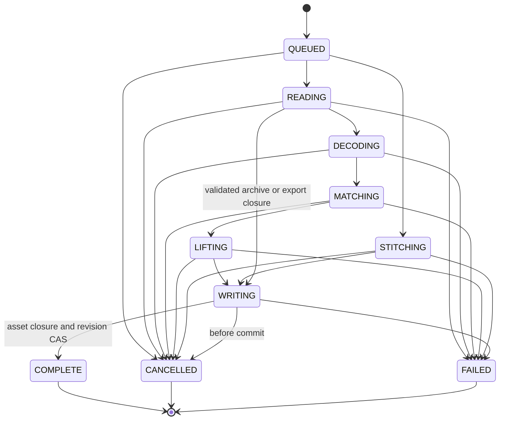

# 4D-Recruiser — multiplatform living-world architecture

Version 2.0 · 2026-10-23 · ARCHITECT phase · Owner: Robin L. M. Cheung, MBA.

**Delivery boundary:** architecture only; hold before CHECKLIST generation, source implementation, builds, and deployment. This is the complete proposed technical snapshot and solution declaration AST, not evidence of implemented software. **Release of UI coder tasks is NOT ATTESTED:** TC12's operator-cleared structured UI export is absent from this checkout. Section 6 defines binding application-side UI contracts; it does not impersonate a Figma/Make/Stitch export. A full architecture-exit attestation cannot truthfully be issued until that source is reconciled. No `✅` is claimed here.

**One source:** this file owns the v2 product contract, algorithms, declarations, task ownership, workflows, and diagrams. `IMPLEMENTATION_PLAN.md` supplies product intent. The Kotlin/Room v1 master at commit `3efcf7d`, its six partials, and `DOCS/CHECKLIST--4d-splat-world.md` are historical donors, not v2 coding instructions. V2 preserves their history but replaces their contracts. The existing project identifier `0192f7c4-8a4d-7c1e-9f3a-4d5b8e7c1a42` is retained as an opaque identifier; the earlier UUIDv8 claim is withdrawn (its version nibble is 7).

## 1. Authority, evidence, and decisions

KStore alone supplies Admin-Manual authority. Retrieval: 2026-10-23, `GET http://192.168.0.87:8788/doc?source_type=admin-manual&id=<percent-encoded path>`, head revision. `exact=false` means KStore served reconstructed legacy content, not byte-exact original Markdown. These observations are authority-read evidence, not evidence that this architecture was written to KStore or semantically indexed.

| KStore document ID | Head | Exact | Governs |
|---|---:|---|---|
| `SPEC_CONVENTIONS.md` | 1 | false | Finished-product snapshot, exhaustive symbols, engaged-by, independent coding |
| `TOOLING_CONVENTIONS/global-agent-rules.md` | 2 | true | Scope, truth, graph, delivery; SHA-256 `e23d0e8d5e7cd48d27d84651c4a9f0925767ed523781fb5f81c57e1a9f2ce3e1` |
| `SPEC_CONVENTIONS/closed-spec-properties.md` | 1 | false | Closed manifests, AD authorization, amendments |
| `SPEC_CONVENTIONS/idempotent-accept-clauses.md` | 1 | false | Four states, isolated end-state checks, independent semantic validation |
| `SPEC_CONVENTIONS/semantic-names-single-source-of-truth.md` | 1 | false | Explicit conflict judgment and source identity |
| `TOOLING_CONVENTIONS/stitch-first-ui-elucidation.md` | 1 | false | TC12: approved structured UI source before UI freeze |
| `TOOLING_CONVENTIONS/multiplatform-application-default.md` | 2 | true | Tauri 2 Windows/Linux/Web/Android; SHA-256 `ebfd22daff28e25d0ec3126db9a78e90d5aad57fca9377b9b1ee079edae6d011` |
| `FILEFORMAT.md` | 2 | true | Self-describing artifacts; SHA-256 `435a6801baa9450a593d72c2252cf68dca6e83a117a6e6d5b1c72b846f85f6a5` |

At initial exploration the native-Windows graph was initialized; `codegraph status` reports current, zero source files/nodes/edges; SQLite `PRAGMA integrity_check` returned `ok`; explore returned no code. CodeGraph explicitly reports Markdown unsupported. Therefore named Markdown reads are the appropriate coverage exception. Every source path below is a **planned path**, never a fabricated `file:line` observation. Source-line attestations are populated only from implemented code at the later verification boundary. Final documentation verification adds one Python verifier to CodeGraph (12 nodes); no application source exists, and SQLite integrity remains ok.

| AD | Decision and rationale | Rejected competing choice |
|---|---|---|
| AD01 | Tauri 2 shells for Windows/Linux/Android; standalone browser/PWA using the same TypeScript domain and rendering code. User explicitly selected this direction and reaffirmed powerful desktop GPU support. | Kotlin/Compose/Room as the product architecture |
| AD02 | Local computation; reconstruct captured surfaces when supported by observations, infer missing surfaces procedurally, preserve confidence and provenance. No cloud inference or undisclosed neural checkpoint. | Claiming luminance equals measured depth or lighting gives absolute position |
| AD03 | Video preserves sampled decoded frames and tracked motion; one monotonic scene clock evaluates every active vignette concurrently. | Replacing arbitrary video motion with a generic sine wave |
| AD04 | WebGPU rendering/compute preferred with high-performance adapter request; WebGL2 GPU rendering plus worker computation is an explicit capability fallback. Desktop budgets scale independently of mobile. | Fixed mobile-wide 500k-splat ceiling; assuming Tauri guarantees WebGPU |
| AD05 | Manual metric layout remains available with weak/nonoverlapping captures. Feature geometry and EXIF are evidence-bearing proposals, never a claimed COLMAP executable. | Deck-row placement labeled automatic geometric reconstruction |
| AD06 | Immutable content-addressed assets plus transactional world revisions; native file adapters and browser IndexedDB implement the same repository port. Portable world archive embeds its interpretation. | Room-specific core, path-only projects, unversioned binary blobs |
| AD07 | UI topology and visual identity follow the supplied brief. Actual exported component identity is a TC12 freeze condition; no screenshot reconstruction or substitute UI authoring in this task. | Declaring an imagined UI export complete |
| AD08 | AST-owned names, injected dependencies, exclusive file owners, immutable contracts, task-local checks, independent reviewer; later checklist is derived rather than improvised. | Parallel writers modifying a shared entrypoint or needing sibling implementations to author their task |
| AD09 | Quest immersive exploration uses the Web build and WebXR; the Android Tauri package is a 2D studio. This is an explicit proposed interpretation of the brief's VR audience, not evidence of Quest acceptance. | Calling an Android panel immersive VR |
| AD10 | Preserve original media, generated/captured distinctions, actual timestamps, lineage and failed-job receipts. No automatic destructive migration. | Synthetic showcase labeled captured, fabricated GPS/focal metadata |

SC3 priority matrix: short = this architecture handoff; medium = implementation/integration; long = portability/recovery. P1 preserves the requested product and latest user decisions; P2 preserves truthful, self-contained contracts; P3 minimizes total work. Tauri/shared GPU path satisfies P1 now, maintains one domain at integration, and preserves cross-platform artifacts long term; Kotlin-only saves short-term reuse but violates P1 and creates a second implementation later. One self-contained master satisfies P2 now and prevents partial-table drift later; standalone historical partials remain labeled archives. The UI export absence is incompatible evidence that prevents attestation; it is not erased by an architecture-completeness assertion.

## 2. Closed product and platform manifest

V2 includes: the living cruise-ship showcase; GLB and PLY viewing; four media kinds (regular/360 still/video); local asset import; EXIF and decoded-frame inspection; depth lifting and feature-based pose proposals; manual transform/projection/lighting editing; geometric bridge synthesis; simultaneous seamless loops; orbit/pan/zoom and viewpoint flights; captured/inferred inspection; project save/reopen and archive import/export; desktop and mobile quality controls; browser immersive Quest exploration. It contains no account, billing, collaboration server, cloud training, social feed, arbitrary model download, or remote media execution. File export is added as the minimum portability/recovery mechanism required by FILEFORMAT, not as a separate publishing service.

Windows 11 x64 and Linux x64 desktops are first-class authoring and high-quality exploration targets, including discrete GPUs. Android arm64 and Quest have lower initial resident-memory and scene-density budgets, not different semantics. Web builds use browser adapters only: no Tauri import executes in a browser. No desktop Python/Node subprocess is a product-runtime dependency. CLI inspection/validation is a Node command using the same archive/domain functions; it does not create a second state model.

| Profile | Resident GPU target | CPU working target | Visible target / maximum user budget | Decoder target | Frame target |
|---|---:|---:|---|---|---|
| mobile | 128 MiB | 256 MiB | 150k / 500k splats | 1024 long edge, 12 samples/s | 60 Hz flat |
| desktop | 512 MiB | 1 GiB | 2M / 8M splats | 2048 long edge, 24 samples/s | 60 Hz flat |
| workstation | 2 GiB | 4 GiB | 8M / 32M splats | original dimensions, source sample rate | 60 Hz flat |
| immersive | 192 MiB | 384 MiB | 200k / 1M splats across both eyes | reuse saved samples | XR session cadence |

These are configurable working budgets, not claims about available VRAM or guaranteed frame rate. Adapter limits are not free-memory measurements. Pages are allocated lazily; effective allocation respects device limits, checked failures, and explicit user budget. Selection starts mobile on touch/Android, desktop otherwise; workstation is an explicit user choice. Geometry residency is LOD-driven; every vignette's logical clock continues even when culled. Report actual visible/total counts, backend, timings, quality, and failures. Never secretly pause other vignettes to make a single loop appear fast. Memory exhaustion evicts regenerable pages first, then lowers resident LOD with an explicit notice; imported originals and committed world state are preserved.

## 3. Module ownership and AST notation

The declaration AST below is the normative **solution AST**, not a parser AST of code that already exists. It enumerates owned modules, public/local cross-function state, records and all their fields, finite enums, commands, functions, platform interfaces, shaders and wiring. Lexical loop indices and compiler-created temporaries have no independent wiring identity; their formulas are specified in §5. Every declared member is part of its parent entity's contract and ownership. No implementation may introduce a new externally wired symbol without an AD amendment.

Notation: `T[]` ordered immutable list unless a typed buffer; `?` nullable, not omitted; `R<T>` = `Promise<Result<T>>`; `Sync<T>` = `Result<T>`; `V3` = three finite doubles in metres, `Q4` normalized quaternion xyzw, `M4` column-major 16 doubles, `RGB` linear RGB [0,1]; `ID` lowercase UUID string; `Hash` lowercase SHA-256; `Bytes` Uint8Array. Tuples, records and enums are closed. Optional environment values become explicit nulls at input boundaries. Standard platform/library types retain their published definitions. A definition cell lists all named fields or the complete callable signature; algorithm references give its behavior. Comma-separated task IDs in Engaged-by are consumers, not shared file ownership.

| Module/task owner | Planned files (exclusive production ownership) | Allowed module dependencies |
|---|---|---|
| C01 contracts | `src/contracts.ts`, `src/ports.ts`, `src/constants.ts` | none |
| G01 geometry | `src/geometry/math.ts`, `src/geometry/feature.ts`, `src/geometry/pose.ts`, `src/geometry/depth.ts` | C01; ml-matrix |
| I01 media | `src/media/decode.ts`, `src/media/metadata.ts`, `src/media/ingest.ts`, `src/media/track.ts` | C01; injected G01; exifr |
| S01 synthesis | `src/world/stitch.ts`, `src/world/scaffold.ts`, `src/world/lighting.ts` | C01; injected G01 |
| T01 temporal | `src/world/clock.ts`, `src/world/temporal.ts` | C01 |
| D01 persistence | `src/storage/repository.ts`, `src/storage/browser.ts`, `src/storage/native.ts` | C01; platform capabilities |
| A01 archive | `src/archive/codec.ts`, `src/archive/manifest.ts`, `src/archive/validate.ts` | C01; zip.js/hash-wasm |
| R01 rendering | `src/render/webgpu.ts`, `src/render/webgl.ts`, `src/render/pages.ts`, `src/render/camera.ts`, `src/render/xr.ts`, `src/render/mesh.ts`, `src/render/shaders/splat.wgsl`, `src/render/shaders/splat.vert`, `src/render/shaders/splat.frag`, `src/render/shaders/sort.wgsl` | C01; injected G01/T01; three for GLB/PLY loading only |
| J01 jobs | `src/jobs/scheduler.ts`, `src/jobs/worker.ts`, `src/jobs/protocol.ts` | C01; injected I01/S01/A01 |
| W01 application | `src/app/reducer.ts`, `src/app/controller.ts`, `src/app/commands.ts` | C01; injected ports only |
| P01 showcase | `src/presets/cruise.ts`, `src/presets/fixtures.ts` | C01; injected S01 |
| U01 UI binding | `src/ui/bindings.ts`, `src/ui/messages.ts`, `src/ui/theme.ts` | C01; injected W01; actual approved export required before UI ownership is frozen |
| H01 platform | `src/platform/browser.ts`, `src/platform/tauri.ts`, `src/platform/capabilities.ts`, `src-tauri/src/lib.rs`, `src-tauri/src/main.rs`, `src-tauri/build.rs`, `src-tauri/Cargo.toml`, `src-tauri/Cargo.lock`, `src-tauri/capabilities/default.json`, `src-tauri/tauri.conf.json` | C01; official Tauri fs/dialog |
| B01 assembly/build | `src/main.tsx`, `src/bootstrap.ts`, `src/worker-bootstrap.ts`, `src/cli.ts`, `index.html`, `package.json`, `package-lock.json`, `tsconfig.json`, `vite.config.ts`, `vitest.config.ts`, `version.json`, `public/manifest.webmanifest`, `public/sw.js`, `scripts/build.mjs`, `scripts/verify-task.mjs` | all through explicit factory injection |

Each owner also owns `tests/<owner-id-lowercase>/` only. A UI export is an input artifact, not something U01 is allowed to redraw. No task edits another owner's constants, exports, application registration, dependency manifest, or test fixtures. B01 alone owns composition and manifests. Contract types are type-only imports; dependency implementations enter factories as ports. Artifact-generation tools and generated lockfiles are declared B01 outputs, not new hand-authored entities.

## 4. Comprehensive entity enumeration

Row IDs are stable AST node IDs. Each row is authorized by the cited AD. Owner is the single writing task; Engaged-by names all task families allowed to wire the entity. Proposed task IDs reserve ownership only: this document neither creates nor approves a new checklist.

| ID | Owner / file suffix | Entity and complete declaration | Uses / behavior | Engaged-by | AD |
|---|---|---|---|---|---|
| E001 | C01 / contracts.ts | `Result<T> = {ok:true,value:T} or {ok:false,error:AppError}`; aliases ID,Hash,Bytes,V3,Q4,M4,RGB,Sync,R as §3 | all operations return typed failure; no swallowed errors | all | AD08 |
| E002 | C01 / contracts.ts | `MediaKind = STILL_REGULAR,STILL_360,VIDEO_REGULAR,VIDEO_360`; `Projection = PERSPECTIVE,SPHERICAL`; `Origin = CAPTURED,INFERRED,PROCEDURAL_DEMO`; `ModelKind = SPLAT_WORLD,GLB,PLY` | explicit user projection; no automatic 2:1 certainty | I01,S01,R01,U01 | AD02 |
| E003 | C01 / contracts.ts | `Backend = WEBGPU,WEBGL2,UNAVAILABLE`; `Profile = MOBILE,DESKTOP,WORKSTATION,IMMERSIVE`; `PoseMethod = IDENTITY,EXIF,FEATURES,MANUAL`; `DepthMethod = TRIANGULATED,RELIEF,SHELL`; `BridgeKind = CORRIDOR,DECK,HULL,WATER,SKY` | closed choice sets | all | AD04 |
| E004 | C01 / contracts.ts | `JobStage = QUEUED,READING,DECODING,MATCHING,LIFTING,STITCHING,WRITING,COMPLETE,CANCELLED,FAILED`; `Tab = LIBRARY,BUILDER,VIEWPOINTS,ENGINE`; `Playback = RUNNING,PAUSED`; `XrState = OFF,REQUESTING,ACTIVE,ENDING,FAILED` | stage transitions §7 | J01,W01,U01 | AD08 |
| E005 | C01 / contracts.ts | `ErrorCode = INVALID_INPUT,UNSUPPORTED_MEDIA,DECODE_FAILED,MISSING_ASSET,HASH_MISMATCH,UNSUPPORTED_VERSION,PERMISSION_DENIED,QUOTA_EXCEEDED,CONFLICT,CANCELLED,GPU_UNAVAILABLE,GPU_LOST,XR_UNAVAILABLE,IO_FAILED,JOB_INTERRUPTED`; `AppError{code:ErrorCode,message:string,entityId:ID?,retryable:boolean}` | stable code → §6 string; detail never contains raw private paths | all | AD10 |
| E006 | C01 / contracts.ts | `Pose{translation:V3,rotation:Q4,scale:number}`; `Camera{position:V3,target:V3,up:V3,fovYRad:number,nearM:number,farM:number}`; `GeoAnchor{latitudeDeg:number,longitudeDeg:number,altitudeM:number?}` | right-handed +Y up, -Z forward; uniform scale >0 | all | AD05 |
| E007 | C01 / contracts.ts | `Metadata{width:number,height:number,durationUs:number,rotationDeg:number,focalMm:number?,sensorWidthMm:number?,focal35Mm:number?,gps:GeoAnchor?,headingRad:number?,exposureEv:number?,sourceMime:string}` | missing metadata stays null | I01,G01,A01,U01 | AD10 |
| E008 | C01 / contracts.ts | `Intrinsics{fx:number,fy:number,cx:number,cy:number,width:number,height:number,estimated:boolean}`; `Lighting{direction:V3,color:RGB,intensity:number,confidence:number}` | pixels in normalized oriented image; intensity≥0 | G01,I01,S01,R01 | AD02 |
| E009 | C01 / contracts.ts | `SourceAsset{id:ID,hash:Hash,name:string,mime:string,byteLength:number,origin:Origin,rights:string,metadata:Metadata}`; `Frame{timeUs:number,width:number,height:number,rgba:Uint8Array}` | rgba length=4WH; decoded timestamp retained | I01,D01,A01,P01 | AD10 |
| E010 | C01 / contracts.ts | `Feature{x:number,y:number,score:number,descriptor:Uint8Array,ray:V3}`; `Match{a:number,b:number,distance:number}`; `PoseProposal{pose:Pose,method:PoseMethod,confidence:number,inliers:number,reprojectionPx:number?,scaleKnown:boolean,reason:string}` | feature descriptor 32 bytes | G01,I01,U01 | AD05 |
| E011 | C01 / contracts.ts | `DepthMap{width:number,height:number,metres:Float32Array,confidence:Float32Array,method:DepthMethod}`; `Observation{pixel:[number,number],point:V3,confidence:number}` | invalid depth=0 with confidence=0, never NaN | G01,I01 | AD02 |
| E012 | C01 / contracts.ts | `SplatPage{id:ID,vignetteId:ID,frameIndex:number,count:number,position:Float32Array,rotation:Float32Array,scale:Float32Array,rgba:Uint8Array,confidence:Uint8Array,origin:Origin,depthMethod:DepthMethod,sh:Float32Array?,bounds:[V3,V3]}` | A4 SoA; rotation 4N, scale/position 3N, rgba4N, confidenceN, SH=12N when present | I01,S01,T01,R01,A01 | AD03 |
| E013 | C01 / contracts.ts | `FrameRef{index:number,timeUs:number,pageHashes:Hash[]}`; `Loop{startUs:number,endUs:number,speed:number,crossfadeUs:number,phaseOffset:number,enabled:boolean}`; `Track{fromFrame:number,toFrame:number,pageIndex:number,sourceIndices:Uint32Array,targetIndices:Int32Array,confidence:Uint8Array}` | unmatched index=-1, retained as opacity fade | I01,T01,D01,A01 | AD03 |
| E014 | C01 / contracts.ts | `Vignette{id:ID,title:string,sourceId:ID,kind:MediaKind,projection:Projection,intrinsics:Intrinsics,pose:Pose,proposal:PoseProposal,depthScale:number,lighting:Lighting,loop:Loop,frames:FrameRef[],trackHashes:Hash[],visible:boolean}` | original capture pose retained in proposal; user pose independent | all | AD05 |
| E015 | C01 / contracts.ts | `WorldSettings{bridgeDensity:number,harmonization:number,autoStitch:boolean,highlightInferred:boolean,showFrustums:boolean,backdrop:string,profile:Profile,gpuBudgetBytes:number,cpuBudgetBytes:number,splatBudget:number}` | validation/defaults E029 | all | AD04 |
| E016 | C01 / contracts.ts | `Scaffold{lengthM:number,beamM:number,deckHeightM:number,deckCount:number,origin:Pose}`; `BridgeLink{id:ID,fromId:ID,toId:ID,kind:BridgeKind,widthM:number,enabled:boolean}`; `BridgeSet{revision:number,dependencyHash:Hash,links:BridgeLink[],pageHashes:Hash[]}` | immutable inferred geometry; stale hash not shown as current | S01,D01,W01 | AD02 |
| E017 | C01 / contracts.ts | `Viewpoint{id:ID,name:string,camera:Camera}`; `World{id:ID,revision:number,title:string,createdUtc:string,updatedUtc:string,kind:ModelKind,geoAnchor:GeoAnchor?,settings:WorldSettings,scaffold:Scaffold,sources:SourceAsset[],vignettes:Vignette[],bridges:BridgeSet,viewpoints:Viewpoint[],meshHash:Hash?}` | all arrays sorted by ID except time-sorted frames | D01,W01,R01,A01,P01 | AD06 |
| E018 | C01 / contracts.ts | `Job{id:ID,worldId:ID,inputRevision:number,kind:'INGEST' or 'STITCH' or 'IMPORT' or 'EXPORT',stage:JobStage,completed:number,total:number?,error:AppError?,outputHashes:Hash[]}`; `JobEvent{jobId:ID,stage:JobStage,completed:number,total:number?,message:string,output:JobOutput?}`; `JobOutput = INGEST{source:SourceAsset,vignette:Vignette},STITCH{bridges:BridgeSet},IMPORT{world:World},EXPORT{archiveHash:Hash,name:string}` | no guessed percentage when total null | J01,W01,U01 | AD08 |
| E019 | C01 / contracts.ts | `Capabilities{native:boolean,webgpu:boolean,webgl2:boolean,xr:boolean,persistentStorage:boolean,maxBufferBytes:number,maxTextureSize:number,maxStorageBindingBytes:number,decoderMimes:string[]}`; `RenderStats{backend:Backend,visibleSplats:number,totalSplats:number,activeLoops:number,cpuMs:number,gpuMs:number?,fps:number,residentBytes:number,quality:string}` | runtime probe, GPU time null if unavailable | H01,R01,U01 | AD04 |
| E020 | C01 / contracts.ts | `UiState{world:World?,library:WorldSummary[],selectedId:ID?,tab:Tab,playback:Playback,camera:Camera,jobs:Job[],stats:RenderStats,capabilities:Capabilities,error:AppError?,dirty:boolean,xr:XrState}`; `WorldSummary{id:ID,title:string,revision:number,kind:ModelKind}` | controller sole state publisher; no 60Hz React world copies | W01,U01 | AD08 |
| E021 | C01 / contracts.ts | `Command{type,payload}` closed discriminated cases: OPEN{id},NEW{title},IMPORT_MEDIA{assets:PickedAsset[],kind:MediaKind},SELECT{id:ID?},POSE{id,pose},PROJECTION{id,projection,fovXRad,depthScale},LIGHTING{id,lighting},LOOP{id,loop},SETTINGS{settings},STITCH{},CANCEL{jobId},PLAY{playback},SAVE_VIEW{name},RECALL_VIEW{id},DELETE_VIEW{id},REMOVE_VIGNETTE{id},EXPORT{},IMPORT_WORLD{asset:PickedAsset},ENTER_XR{},EXIT_XR{},TAB{tab},ACK_ERROR{} | every payload fully defined here; no arbitrary field patches | W01,U01,B01 | AD08 |
| E022 | C01 / contracts.ts | `Action = REPLACE_WORLD{world},LIBRARY{items:WorldSummary[]},SELECT{id},TAB{tab},PLAY{playback},CAMERA{camera},JOB{job},STATS{stats},CAPABILITIES{capabilities},ERROR{error:AppError?},DIRTY{value:boolean},XR{state:XrState}` | reducer input set; all other domain mutation through World revision | W01 | AD08 |
| E023 | C01 / contracts.ts | `PickedAsset{name:string,mime:string,size:number,handle:string}`; `AssetReader{size:number,read(offset:number,length:number):R<Bytes>,close():void}`; `Disposer=()=>void`; `CancelToken{cancelled:boolean,throwIfCancelled():void}` | opaque handle scoped to platform session; no persistent foreign URI reliance | H01,I01,A01 | AD06 |
| E024 | C01 / ports.ts | `StoragePort{get(hash:Hash):R<Bytes>,put(bytes:Bytes):R<Hash>,open(hash:Hash):R<AssetReader>,putStream(chunks:AsyncIterable<Bytes>):R<Hash>,load(id:ID):R<World>,commit(world:World,expectedRevision:number):R<World>,list():R<WorldSummary[]>,journal(job:Job):R<void>,jobs():R<Job[]>}` | hash is content-address, commit compare-and-swap; A10 | D01,J01,W01,A01 | AD06 |
| E025 | C01 / ports.ts | `MediaPort{pick():R<PickedAsset[]>,open(asset:PickedAsset):R<AssetReader>,metadata(asset:PickedAsset):R<Metadata>,frames(asset:PickedAsset,timesUs:number[],longEdge:number,cancel:CancelToken):AsyncIterable<Frame>}` | ordered actual decoded frames, failure terminates with typed AppError | I01,H01 | AD03 |
| E026 | C01 / ports.ts | `RendererPort{load(world:World):R<void>,resize(width:number,height:number,pixelRatio:number):void,frame(clockUs:number,camera:Camera):void,stats():RenderStats,enterXR():R<void>,exitXR():R<void>,dispose():void}`; `ClockPort{nowUs():number}` | immutable page references; renderer owns GPU resources | R01,T01,W01,B01 | AD04 |
| E027 | C01 / ports.ts | `GeometryPort{intrinsics(meta:Metadata,fovXRad:number?):Intrinsics,features(frame:Frame,projection:Projection,k:Intrinsics):Feature[],match(a:Feature[],b:Feature[]):Match[],pose(a:Feature[],b:Feature[],matches:Match[],ka:Intrinsics,kb:Intrinsics,seed:number):PoseProposal,exif(meta:Metadata,anchor:GeoAnchor?):PoseProposal,triangulate(a:Feature[],b:Feature[],matches:Match[],pose:Pose,ka:Intrinsics,kb:Intrinsics):Observation[],depth(frame:Frame,points:Observation[],depthScale:number,projection:Projection):DepthMap,lift(frame:Frame,depth:DepthMap,k:Intrinsics,projection:Projection,vignetteId:ID,profile:Profile):SplatPage[]}` | concrete implementations E034–E039; no platform globals | G01,I01 | AD02 |
| E028 | C01 / ports.ts | `JobPort{submit(kind:Job['kind'],world:World,input:unknown):R<ID>,cancel(id:ID):void,subscribe(fn:(event:JobEvent)=>void):Disposer}`; `PlatformPort{storage:StoragePort,media:MediaPort,clock:ClockPort,save(name:string,source:AssetReader):R<void>,probe():R<Capabilities>,onSuspend(fn:()=>void):Disposer,onResume(fn:()=>void):Disposer,lastWorld():R<ID?>,setLastWorld(id:ID):R<void>}` | unknown validated by job kind before queueing; events no analysis/transcript content | J01,H01,W01,B01 | AD08 |
| E029 | C01 / constants.ts | `DEFAULTS{fovXRad:70*pi/180,depthScale:1,nearM:.05,farM:10000,scale:1,crossfadeUs:500000,bridgeDensity:1,harmonization:.8,autoStitch:false,scaffold:[120,24,3.2,6],pageSplats:16384,debounceMs:250}`; `PROFILE_BUDGETS` exact §2; `PALETTE{background:'#0D0F14',onyx:'#050508',ocean:'#071A26',glass:'rgba(19,23,34,.8)',primary:'#00BFFF',live:'#00FFCC',inferred:'#E040FB'}` | all settings writers validate; persisted defaults materialized once | all | AD08 |
| E030 | C01 / contracts.ts | `Resource{path:string,role:string,hash:Hash,byteLength:number,mime:string}`; `Dependency{id:string,role:string,version:string,sourceUrl:string,license:string,bundled:boolean,resources:Hash[]}`; `Producer{id:string,name:string,purpose:string,url:string,version:string,commit:string,dirty:boolean,build:string}` | FILEFORMAT envelope types | A01,B01 | AD06 |
| E031 | C01 / contracts.ts | `Manifest{family:'robin.self-describing-artifact',profile:'recruiser.world/2',version:2,artifactId:ID,title:string,description:string,createdUtc:string,privacy:'private',producer:Producer,operations:string[],entrypoints:Record<string,string>,resources:Resource[],dependencies:Dependency[],parentArtifactId:ID?,sourceHashes:Hash[],settings:WorldSettings,rights:string,offlineReady:boolean,requiredFeatures:string[],schemaPath:string,specPath:string}` | A11 no external schema refs; no required models | A01,D01 | AD10 |
| E032 | G01 / math.ts | `poseMatrix(pose:Pose):M4`; `applyPose(pose:Pose,point:V3):V3`; `rotateNormal(pose:Pose,normal:V3):V3`; `interpolatePose(a:Pose,b:Pose,t:number):Pose` | A1, quaternion slerp, normalized normals | I01,S01,R01,W01 | AD05 |
| E033 | G01 / math.ts | `srgbToLinear(value:number):number`; `linearToSrgb(value:number):number`; `normalize3(v:V3,fallback:V3):V3`; `seededRandom(seed:number):()=>number` | IEC sRGB piecewise; xorshift32 seed0→1 | G01,I01,S01,P01 | AD02 |
| E034 | G01 / pose.ts | `inferIntrinsics(meta:Metadata,fovXRad:number?):Intrinsics`; `exifPose(meta:Metadata,anchor:GeoAnchor?):PoseProposal` | A2; absolute GPS relative ENU; unknown scale remains unknown | I01 | AD05 |
| E035 | G01 / feature.ts | `detectFeatures(frame:Frame,projection:Projection,k:Intrinsics):Feature[]`; `matchFeatures(a:Feature[],b:Feature[]):Match[]` | A3 corner detector/BRIEF/mutual ratio | I01 | AD05 |
| E036 | G01 / pose.ts | `solveRelativePose(a:Feature[],b:Feature[],matches:Match[],ka:Intrinsics,kb:Intrinsics,seed:number):PoseProposal`; `triangulate(a:Feature[],b:Feature[],matches:Match[],pose:Pose,ka:Intrinsics,kb:Intrinsics):Observation[]` | A3 normalized essential matrix, cheirality, degeneracy; pose maps B into A | I01 | AD05 |
| E037 | G01 / depth.ts | `estimateDepth(frame:Frame,points:Observation[],depthScale:number,projection:Projection):DepthMap` | A4 observed depth interpolation; relief fallback marked inferred | I01 | AD02 |
| E038 | G01 / depth.ts | `liftFrame(frame:Frame,depth:DepthMap,k:Intrinsics,projection:Projection,vignetteId:ID,profile:Profile):SplatPage[]` | A4 oriented covariance; row-major stable source indices | I01,P01 | AD03 |
| E039 | G01 / pose.ts | `createGeometry():GeometryPort` | exact bindings E034–E038; only composition for G01 | B01 | AD08 |
| E040 | I01 / metadata.ts | `readImageMetadata(bytes:Bytes,mime:string):Sync<Metadata>`; `estimateLighting(frame:Frame,projection:Projection):Lighting` | exifr missing tags null; A5 lighting estimate | I01,S01 | AD02 |
| E041 | I01 / decode.ts | `decodeFrames(port:MediaPort,asset:PickedAsset,rate:number,longEdge:number,cancel:CancelToken):AsyncIterable<Frame>` | A6, no repeated sync-keyframe substitution, close all handles | I01 | AD03 |
| E042 | I01 / track.ts | `trackFrames(a:Frame,b:Frame,projection:Projection,step:number):Track[]` | A7 actual patch tracking, wrap sphere x, occlusion rejection | I01,T01 | AD03 |
| E043 | I01 / ingest.ts | `ingestVignette(input:{asset:PickedAsset,kind:MediaKind,world:World},deps:{media:MediaPort,storage:StoragePort,geometry:GeometryPort},cancel:CancelToken,emit:(event:JobEvent)=>void):R<{source:SourceAsset,vignette:Vignette}>` | A6 original-copy→decode→proposal→pages/tracks→result; does not commit World | J01 | AD08 |
| E044 | S01 / lighting.ts | `harmonize(color:RGB,from:Lighting,to:Lighting,amount:number):RGB`; `fitSH(samples:{normal:V3,color:RGB}[]):Float32Array` | A8 first-order SH, linear exposure match | S01,R01 | AD02 |
| E045 | S01 / scaffold.ts | `scaffoldSurfaces(scaffold:Scaffold,kind:BridgeKind):Surface[]`; `Surface{id:ID,origin:V3,u:V3,v:V3,widthM:number,heightM:number,normal:V3}` | A8 ship local planes and ellipsoidal hull patches | S01,P01 | AD02 |
| E046 | S01 / stitch.ts | `selectBridgeLinks(world:World,bounds:Record<ID,[V3,V3]>):BridgeLink[]`; `sampleBridge(link:BridgeLink,world:World,sources:SplatPage[]):SplatPage[]` | A8 nearest compatible boundaries, corridors/decks/hull/water/sky | S01 | AD02 |
| E047 | S01 / stitch.ts | `stitchWorld(world:World,storage:StoragePort,cancel:CancelToken,emit:(event:JobEvent)=>void):R<BridgeSet>` | recompute dependency hash, immutable output, no captured mutation | J01 | AD02 |
| E048 | T01 / clock.ts | `createClock(source:ClockPort):AmbientClock`; `AmbientClock{nowUs():number,pause():void,resume():void,seek(us:number):void}` | monotonic origin plus accumulated active time; A9 | W01,R01 | AD03 |
| E049 | T01 / temporal.ts | `loopSample(clockUs:number,loop:Loop,frames:FrameRef[]):LoopSample`; `LoopSample{a:number,b:number,mix:number,seamA:number,seamB:number,seamMix:number,seamWeight:number,phase:number}` | A9 actual timestamps, seam two streams | R01 | AD03 |
| E050 | T01 / temporal.ts | `evaluateTrack(a:SplatPage,b:SplatPage,track:Track,mix:number):SplatPage[]` | A9 position/scale/color interpolation and births/deaths | R01 | AD03 |
| E051 | D01 / repository.ts | `createRepository(adapter:StoragePort):WorldRepository`; `WorldRepository{open(id:ID):R<World>,save(world:World,expected:number):R<World>,list():R<WorldSummary[]>,recover():R<Job[]>}` | A10 invariants, revision CAS, asset closure, interrupted jobs | W01,B01 | AD06 |
| E052 | D01 / browser.ts | `createBrowserStorage(name:string):R<StoragePort>` | IndexedDB schema A10, transaction atomicity | H01 | AD06 |
| E053 | D01 / native.ts | `createNativeStorage(fs:NativeFiles):R<StoragePort>`; `NativeFiles{read(path:string):R<Bytes>,write(path:string,bytes:Bytes):R<void>,size(path:string):R<number>,readRange(path:string,offset:number,length:number):R<Bytes>,writeRange(path:string,offset:number,bytes:Bytes):R<void>,flush(path:string):R<void>,rename(from:string,to:string):R<void>,list(path:string):R<string[]>,mkdir(path:string):R<void>}` | A10 app-private relative paths only, immutable commit journal | H01 | AD06 |
| E054 | A01 / codec.ts | `encodePage(page:SplatPage):Sync<Bytes>`; `decodePage(bytes:Bytes):Sync<SplatPage>`; `encodeTrack(track:Track):Sync<Bytes>`; `decodeTrack(bytes:Bytes):Sync<Track>` | A11 descriptors+bounded LE arrays, preserves every field | D01,I01,S01,R01 | AD06 |
| E055 | A01 / manifest.ts | `createManifest(world:World,resources:Resource[],producer:Producer):Manifest`; `canonicalJson(value:unknown):Sync<Bytes>`; `hashBytes(bytes:Bytes):R<Hash>` | A11 sorted keys, finite JSON, SHA-256 | D01,A01,J01 | AD06 |
| E056 | A01 / validate.ts | `validateArchive(source:AssetReader,storage:StoragePort):R<ValidatedArchive>`; `ValidatedArchive{manifest:Manifest,world:World,resources:Resource[]}` | A11 bounded ZIP, hashes, closed schema, offline | A01,W01,CLI | AD10 |
| E057 | A01 / codec.ts | `exportWorld(world:World,storage:StoragePort,producer:Producer,cancel:CancelToken):R<Hash>`; `importWorld(source:AssetReader,storage:StoragePort,cancel:CancelToken):R<World>` | validate before staging; import new world ID retains lineage | J01,CLI | AD06 |
| E058 | R01 / pages.ts | `createPageCache(storage:StoragePort,budgetBytes:number):PageCache`; `PageCache{acquire(hash:Hash):R<SplatPage>,release(hash:Hash):void,evict():void,residentBytes():number,dispose():void}` | LRU unpinned pages; two frames plus seam window pinned per visible vignette | R01 | AD04 |
| E059 | R01 / pages.ts | `selectVisible(world:World,camera:Camera,budget:number):PageSelection`; `PageSelection{hashes:Hash[],strides:Record<Hash,number>,total:number}` | A12 projected-area allocation, stable per-vignette representation | R01 | AD04 |
| E060 | R01 / webgpu.ts | `createWebGpuRenderer(canvas:HTMLCanvasElement,deps:RenderDeps):R<RendererPort>`; `RenderDeps{storage:StoragePort,temporal:{sample:typeof loopSample,evaluate:typeof evaluateTrack},capabilities:Capabilities,onError:(error:AppError)=>void}` | A12 raw WebGPU; high-performance adapter; checked device limits | B01 | AD04 |
| E061 | R01 / webgl.ts | `createWebGlRenderer(canvas:HTMLCanvasElement,deps:RenderDeps):R<RendererPort>` | A12 WebGL2 instanced ellipses; Worker stable depth sort | B01 | AD04 |
| E062 | R01 / camera.ts | `orbit(camera:Camera,dx:number,dy:number):Camera`; `pan(camera:Camera,dx:number,dy:number,viewportHeight:number):Camera`; `zoom(camera:Camera,delta:number):Camera`; `flight(from:Camera,to:Camera,t:number):Camera` | A13 pitch±89°, exponential distance, smoothstep 600ms | W01,R01,U01 | AD05 |
| E063 | R01 / xr.ts | `createXrSession(gl:WebGL2RenderingContext,onState:(state:XrState)=>void):R<XrSession>`; `XrSession{views():XrView[],input():XrInput,end():R<void>}`; `XrView{view:M4,projection:M4,viewport:[number,number,number,number]}`; `XrInput{move:[number,number],snap:number,exit:boolean}` | A13 immersive-vr local-floor; per-eye sort; controller deadzone | R01,W01 | AD09 |
| E064 | R01 / mesh.ts | `decodeMesh(bytes:Bytes,kind:ModelKind):R<MeshAsset>`; `MeshAsset{positions:Float32Array,normals:Float32Array,indices:Uint32Array,colors:Float32Array,images:Bytes[]}` | self-contained GLB and PLY; reject external URIs; no executable extensions | I01,R01 | AD10 |
| E065 | R01 / shaders/splat.wgsl | `vs_main`, `fs_main`; `FrameUniforms{view:M4,projection:M4,viewport:[number,number],highlight:number,phase:number}`; `PageBindings{base:storage,temporal:storage,order:storage,uniforms:uniform}` | A12 Gaussian covariance projection and premultiplied output | R01 | AD04 |
| E066 | R01 / shaders/sort.wgsl | `keys_main`, `histogram_main`, `scan_main`, `scatter_main`; `SortUniforms{count:u32,shift:u32}`; `SortBuffers{keys,indices,histograms,prefixes,scratch}` | A12 eight radix passes, stable workgroup offsets | R01 | AD04 |
| E067 | R01 / shaders/splat.vert,splat.frag | `main` in each; `aCorner:vec2`, `aIndex:uint`, `uView:mat4`, `uProjection:mat4`, `uViewport:vec2`, `uPage:sampler2D`, `uPhase:float`, `uHighlight:float`, `vColor:vec4`, `vEllipse:vec2` | same A12 math; texture fetch replaces storage-buffer reads | R01 | AD04 |
| E068 | J01 / protocol.ts | `WorkerRequest{jobId:ID,inputRevision:number,world:World,kind:Job['kind'],input:unknown}`; `WorkerServiceRequest{serviceId:ID,jobId:ID,method:READ_ASSET or WRITE_ASSET or OPEN_ASSET or READ_RANGE or CLOSE_ASSET or STREAM_BEGIN or STREAM_CHUNK or STREAM_END or METADATA or FRAME or COMMIT or LIST or JOURNAL or JOBS or LOAD,payload:unknown}`; `WorkerServiceReply{serviceId:ID,result:Result<unknown>}`; `WorkerReply = PROGRESS{event:JobEvent},RESULT{jobId,revision:number,output:JobOutput},ERROR{jobId,error:AppError}` | payload validation per A14; transferred buffers ownership explicit | J01,W01 | AD08 |
| E069 | J01 / scheduler.ts | `createScheduler(deps:JobDeps):JobPort`; `JobDeps{storage:StoragePort,ingest:typeof ingestVignette,stitch:typeof stitchWorld,importArchive:typeof importWorld,exportArchive:typeof exportWorld,media:MediaPort,geometry:GeometryPort,producer:Producer}` | A14 queued concurrency/cancellation/stale result rejection | W01,B01 | AD08 |
| E070 | J01 / worker.ts | `runWorker(request:WorkerRequest,deps:JobDeps,cancel:CancelToken,emit:(reply:WorkerReply)=>void):Promise<void>` | A14 dispatcher; pure workers never assume DOM video decoding | J01 | AD08 |
| E071 | W01 / reducer.ts | `reduce(state:UiState,action:Action):UiState`; `initialState(capabilities:Capabilities):UiState` | immutable validated UI state; no I/O | W01,U01 | AD08 |
| E072 | W01 / commands.ts | `validateCommand(value:unknown):Sync<Command>`; `applyWorldCommand(world:World,command:Command):Sync<World>` | A15 closed cases; revision unchanged until storage CAS | W01 | AD08 |
| E073 | W01 / controller.ts | `createController(deps:ControllerDeps):Controller`; `Controller{dispatch(command:Command):R<void>,snapshot():UiState,subscribe(fn:(state:UiState)=>void):Disposer,dispose():void}`; `ControllerDeps{repository:WorldRepository,jobs:JobPort,platform:PlatformPort,renderer:RendererPort,clock:AmbientClock,preset:()=>World,navigation:{orbit:typeof orbit,pan:typeof pan,zoom:typeof zoom,flight:typeof flight}}` | A15 exact orchestration and dirty/error semantics | B01,U01 | AD08 |
| E074 | P01 / cruise.ts | `createCruiseWorld():World`; `createCruisePages():SplatPage[]` | A16 four procedural demonstration vignettes and inferred hull; reproducible IDs | B01,W01 | AD10 |
| E075 | P01 / fixtures.ts | `createGeometryFixtures():FixtureSet`; `FixtureSet{translation:Pose,points:V3[],frames:Frame[],matches:Match[],expected:Record<string,number>}` | A17 real generated numeric fixtures; not fake production success | G01,I01,S01,T01,R01 | AD08 |
| E076 | U01 / bindings.ts | `bindStudio(root:HTMLElement,controller:Controller):Disposer`; `StudioBinding{selector:string,event:string,command:Command['type'],statePaths:string[]}`; `STUDIO_BINDINGS:StudioBinding[]` | §6 complete binding contract; source selectors require TC12 reconciliation | B01 | AD07 |
| E077 | U01 / messages.ts | `MESSAGES:Record<ErrorCode,string>`; `formatTelemetry(stats:RenderStats,camera:Camera):Record<string,string>` | §6 strings, null GPU time shown unavailable; actual counts | U01 | AD07 |
| E078 | U01 / theme.ts | `THEME{palette:typeof PALETTE,fontFamily:string,monoFamily:string,headerTrackingPx:number,minTargetPx:number,panelWidthPx:number,compactBreakpointPx:number}` | §6; consumes palette, no duplicated color literals | U01 | AD07 |
| E079 | H01 / capabilities.ts | `probeCapabilities():R<Capabilities>`; `chooseBackend(capabilities:Capabilities,immersive:boolean):Backend` | WebGPU preferred flat; WebGL2 required XR; none→typed failure | B01,R01,U01 | AD04 |
| E080 | H01 / browser.ts | `createBrowserPlatform():R<PlatformPort>` | A18 IndexedDB/Blob/HTML file input/media; visibility events | B01 | AD01 |
| E081 | H01 / tauri.ts | `createTauriPlatform():R<PlatformPort>` | A18 dialog/fs app-private content, decoder Blob URLs; mobile content URI handling | B01 | AD01 |
| E082 | H01 / lib.rs,main.rs,build.rs | `run()->()`; desktop `main()->()` calls run; build `main()->()` calls tauri_build; `run` registers desktop single-instance first, then fs/dialog plugins and the generated mobile entrypoint | no custom domain IPC, no Kotlin product logic | B01 | AD01 |
| E083 | B01 / bootstrap.ts,main.tsx | `bootstrap(canvas:HTMLCanvasElement,studio:HTMLElement):R<Disposer>`; `mountApplication():Promise<void>`; `bootstrapWorker(port:MessagePort):void` in `src/worker-bootstrap.ts` | A19 explicit constructors and injection; one app instance | B01 | AD08 |
| E084 | B01 / cli.ts | `runCli(argv:string[],io:CliIO):Promise<number>`; `CliIO{read(path:string):R<AssetReader>,write(text:string):void}` | inspect FILE / validate FILE only; 0 valid,2 invalid,3 I/O | CLI | AD06 |
| E085 | B01 / build.mjs | `buildTarget(target:string):Promise<void>`; `readVersion():BuildIdentity`; `BuildIdentity{version:string,buildMinutes:number,commit:string,dirty:boolean,target:string}` | A20 closed targets; no cloud deployment | B01 | AD01 |
| E086 | B01 / verify-task.mjs | `verifyTask(taskId:string):Promise<number>`; `TaskReceipt{taskId:string,contractHash:Hash,sourceHashes:Record<string,Hash>,checks:string[],exitCode:number,reviewer:string?}` | A21 isolated structural+semantic checks; does not award ✅ | all | AD08 |
| E087 | B01 / sw.js | `install`, `activate`, `fetch` handlers; `CACHE_NAME:string` derived from BuildIdentity | A18 precache app shell only, no imported media auto-upload | B01 | AD01 |

The syntax-level AST is completed by the algorithm-local bindings in §5, the UI binding symbols in §6, the closed file/config/schema members in §8, and the task manifest in §9. Diagrams below derive from these IDs and owners; a diagram never overrides a declaration. AST member names include every field inside a record row and every named uniform; table row count is not a claim that each row is one scalar symbol.

## 5. Algorithms, storage semantics, and failure behavior

**A1 — Coordinates and transforms (E032–E033).** World coordinates are metres, +X starboard/right, +Y up, ship bow toward -Z. Image pixels have +u right,+v down, origin at upper left. `M=T*R*S`; point `pWorld=t+R(q)*(s*pLocal)`. Normal `nWorld=normalize(R(q)*nLocal)`; covariance `SigmaWorld=s²*R*SigmaLocal*Rᵀ`. UI Euler input uses yaw about +Y, pitch about +X, roll about +Z, composed `qY*qX*qZ`, degrees converted once. Display extraction uses that same order, gimbal lock retains previous yaw and solves roll. Quaternion interpolation takes shortest arc, normalizes, uses nlerp when dot>.9995. Test translation (1,2,3), yaw90°, scale2 maps origin to (1,2,3) and local (1,0,0) to (1,2,1), correcting v1's scaled translation. `normalize3` uses fallback when squared length<1e-12. sRGB decode threshold .04045, division12.92; otherwise ((c+.055)/1.055)^2.4; inverse threshold .0031308. xorshift32 uses shifts13,17,5 unsigned and divides by 2^32.

**A2 — Intrinsics and EXIF (E034,E040).** Apply EXIF orientation exactly once before features; rotation affects dimensions/principal point. If focal35Mm exists, `fx=W*focal35Mm/36`; else if focalMm and sensorWidthMm exist use `W*focalMm/sensorWidthMm`; else explicit fovX/default70° yields `fx=W/(2*tan(fovX/2))` and estimated=true. `fy=fx`, `cx=(W-1)/2`, `cy=(H-1)/2`. Never combine sensor focal length with a fabricated 36mm sensor. GPS converts WGS84 to ECEF (a6378137,e².00669437999014) then ENU about first accepted world anchor: world=(east,up,-north). Missing altitude sets relative Y=0 with confidence .25; heading-only proposal yaw=-heading with confidence .2; no GPS/heading returns identity/confidence0/reason 'Manual placement required'. GPS never chooses a deck automatically. Estimated lighting never stands in for GPS/heading. Changing projection regenerates derived pages from preserved media and retains the existing world until success.

**A3 — Feature matching, pose and triangulation (E035–E036).** Gray=linear RGB weighted .2126,.7152,.0722. Three-level 2x box pyramid; FAST-9 with radius3 and threshold .08, score=sum absolute ring differences; 3x3 nonmax suppress; stable sort score descending, then y,x; retain 2000 per image. BRIEF uses 256 pairs from xorshift32(seed=314159), integer offsets uniformly in [-15,15], clamp at perspective edges and wrap horizontally for spherical input; descriptor bits compare two gray samples. Mutual nearest Hamming matches pass best/second<.75 and best<=64; ties index ascending. Perspective Feature.ray is normalized ((x-cx)/fx,-(y-cy)/fy,-1); spherical Feature.x/y retain original equirectangular coordinates and ray is the normalized world-local bearing. For panoramas, project six 90° cube faces (512 square at default; proportional to capture profile); annotate face rays before matching and score in spherical angular reprojection. Solve bearing-ray epipolar constraint with normalized eight-point SVD, enforce essential singular values (s,s,0). RANSAC seed=first32bits(source hash), 1024 trials of 8 unique matches; inlier threshold angular equivalent of 2 pixels at image fx, choose max count then lowest error then iteration index. Require >=24 inliers, >=.35 fraction, median parallax>=1°; four E decompositions select most positive-depth points, require >=.8. Degenerate/pure-rotation/low-overlap returns identity confidence0 and reason, never a fabricated translation. Unit translation is scale-unknown until GPS baseline or manual scale anchors it. With anchors, baseline ratio sets scale; conflicting anchors (>20% residual) retain manual pose and report proposal confidence0. Triangulate by homogeneous 4x4 SVD, positive depth, reprojection<=2px, finite depth [.05,10000]. Relative pose maps candidate B into reference A and is composed with A's world pose. This is a specified sparse SfM method, not a claim of bundle-adjusted COLMAP quality. `ml-matrix` supplies SVD only; matches and geometry live in G01.

**A4 — Depth and splat lifting (E037–E038).** Where >=3 valid triangulated observations surround a pixel, use inverse-distance weighted depth from its nearest 8 observations inside radius W/8, confidence=mean observation confidence times exp(-nearestDistance/(W/8)). No supporting observations: explicit relief `z=depthScale*(1+4*(.7*(1-L)+.3*v/max(1,H-1)))` metres, confidence .1, method RELIEF; spherical default radius=12*depthScale, method SHELL. Single-image depth is inferred, never measured. Grid step=max(1,ceil(sqrt(W*H/profileTargetSamples))); profileTargetSamples=4096 mobile,16384 desktop,65536 workstation. Perspective ray=((u-cx)/fx,-(v-cy)/fy,-1), point=ray*z; spherical theta=2pi*(u+.5)/W-pi, phi=pi/2-pi*(v+.5)/H, point=z*(cos(phi)*sin(theta),sin(phi),-cos(phi)*cos(theta)). Tangent axes use adjacent ray derivatives, orthonormalized; sigma tangent=max(.002,footprint*.6), normal sigma=max(.001,min(sigmaU,sigmaV)*.15). Quaternion rotates basis into world-local axes; all covariance eigenvalues positive. Store per-frame pages of <=16384 samples, stable row-major identities; zero-depth samples opacity0. Color from actual input and confidence are independent from Origin: captured color can have inferred depth. DepthMethod is retained on the vignette's page descriptor metadata; generated bridges and demos never use CAPTURED. Bounds include 3sigma extents. No unit error multiplying pixel focal length into metric Z.

**A5 — Lighting (E040,E044).** Use top1% linear luminance pixels, stable ties by pixel index; weighted mean spherical/pinhole ray gives estimated direction, mean color gives RGB, overall mean luminance gives intensity, confidence=.2 absent calibrated illumination. Empty/black image returns direction(0,1,0), color(1,1,1), intensity0, confidence0; label this estimated, not EXIF fact. User warmth adjusts red/blue gains exp(±.3*w), w∈[-1,1], then preserve luminance; intensity multiplier∈[0,4]. Harmonize inferred RGB by blend amount toward exposure ratio clamp(to.intensity/max(from.intensity,.001),.25,4) and normalized color gains. Captured colors remain unchanged unless user explicitly edits that vignette. First-order SH uses basis [.282095,.488603*y,.488603*z,.488603*x], solve ridge least-squares λ=.001 for each channel; 12 coefficients. Insufficient samples use ambient coefficient color/.282095 and zero directional coefficients.

**A6 — Import pipeline (E041,E043).** Validate kind/mime, size>0, finite metadata/duration, user-granted read. Copy original bytes to content-addressed storage before releasing picker handle; hash while reading 4MiB blocks; never store an ephemeral Blob URL as a durable source. Stills decode once, videos sample t=start+n/rate with final t<end; no silent clip truncation, adaptive resampling, audio inference, or first-frame-only substitute. User loop defaults to full duration; decode the full chosen interval in bounded batches. Actual decoder timestamps drive FrameRef; duplicates are coalesced with a recorded sample count. A failed/missing frame fails the job with last completed checkpoint; original source remains reusable. Decoder uses HTML video seeked plus requestVideoFrameCallback when available, otherwise seeked+canvas draw with actual currentTime; 10s per-frame timeout, release video/canvas/URLs on every exit. Workers receive transferred pixel buffers from the main-thread decoder, not DOM objects. Process metadata→features against up to8 reference vignettes nearest GPS/manual anchor (otherwise ID order)→proposal→depth→lift→tracks→write immutable pages. Commit the new vignette only after all referenced hashes exist and world revision still matches; no partially visible result. Image/video decoding capability is probed on real file; unsupported HEVC/etc returns UNSUPPORTED_MEDIA with explicit conversion instruction, not a claimed platform guarantee.

**A7 — Video correspondence (E042).** Three-level pyramidal Lucas–Kanade at splat grid points; window7x7, 10 Gauss–Newton iterations per level, stop step<.01px; singular normal matrix determinant<1e-6 fails track. Forward-backward error>1.5px or normalized patch residual>.1 rejects it; spherical sampling wraps x, clamps y. Nearest target sample within one grid step yields target index; collisions keep lowest residual then source index. Tracks are page-local (pageIndex identifies row-major source/target page); a correspondence outside that page is marked unmatched and rendered by the two-layer fallback. Unmatched target/source samples are births/deaths, not fictitious velocity. Store track confidence 0..255. Adjacent decoded frames preserve color change and scene motion; low-texture/untrackable sequences crossfade separate Gaussian layers at their actual frame positions. Both layers remain capture-derived; do not replace motion with periodic warping.

**A8 — Structural synthesis (E044–E047).** Use pose-transformed observed/inferred vignette bounds and scaffold coordinates. Automatic adjacency: for each vignette choose at most2 neighbors within30m, sort distance then ID, same deck |dy|<=1.6m→CORRIDOR; vertical pairs produce no corridor until explicitly positioned to a common deck. Deduplicate unordered ID pairs. Surface planes: DECK at n*deckHeight for n=0..deckCount-1 over length×beam; WATER at y=-1 over 2length×2beam; SKY is inward hemisphere radius2length; HULL ellipsoid x/(beam/2), z/(length/2), y/(deckHeight*deckCount) clipped y<=0 relative lowest deck. CORRIDOR is a rectangular floor/wall/ceiling prism joining closest bounds, width default2m, height2.4m, floor normal+Y, door ends open. Exclude cells inside a vignette AABB expanded .25m and never overwrite captured samples. Sample surfaces at spacing .5/max(density,.1) metres; density0 produces no new bridges. Fit boundary color/light using nearest8 samples within3m, otherwise neutral(.35,.35,.35) marked inferred with confidence0. Fixed seed=dependency hash, jitter<=.1*spacing avoids perfect grids; preserve surface bounds. Hull/water/sky generation follows explicit scaffold, not a claim to recover hidden real-world rooms. Store first-order SH, local covariance and origin INFERRED; bridge geometry is static, water demo animation is explicitly procedural. Dependency hash covers ordered vignette IDs/poses/page hashes/lighting/settings/scaffold/links/algorithm version; replacement commits only for that hash. Work bounded by profile batch budgets with cancellation every page; streaming persists all pages without a global count truncation.

**A9 — Time (E048–E050).** Clock is performance.now-derived monotonic microseconds; maintain originUs, pausedUs, accumulatedUs. Suspend freezes scene time; resume starts a new origin without jump. For each enabled vignette independently `duration=end-start`, `c=min(crossfadeUs,duration/4)`, effectivePeriod=duration-c, `phase=fract(clockUs*speed/effectivePeriod+phaseOffset)`, `sampleUs=start+c+phase*effectivePeriod`; speed [.1,4], phaseOffset[0,1), duration>0. The effective-period expression is the normative phase; c=0 naturally reduces it to the full duration. Binary-search real FrameRef times, interpolate surrounding frames with clamped ratio. Last window overlaps end samples with beginning samples at `start+(sampleUs-(end-c))`: w=smoothstep(0,1,(sampleUs-(end-c))/c). LoopSample.a/b/mix describe the main frame bracket; seamA/seamB/seamMix describe the beginning-stream bracket; seamWeight=w (0 outside overlap), phase is the normalized effective period. At wrap both the previous seam stream and the new main stream reach start+c, so output is continuous; c=0 bypasses seam division and uses the full interval. Track-valid positions/scale/linear color interpolate; quaternions slerp; unmatched samples fade alpha 1-t/t. Evaluated output is split into pages of at most16384 samples, including births/deaths, so interpolation never violates page capacity. Seam combines two evaluated layers with premultiplied weights, not sin(phase) and sin(phase-1), which are identical. Static stills do not animate. Shared render timestamp evaluates all vignettes, including hidden ones' logical phases; no per-vignette timers.

**A10 — Transactional storage (E051–E053).** Browser IndexedDB database `recruiser-v2`, schemaVersion2: stores `assets` key hash→{hash,byteLength,chunkCount}; `chunks` composite key [hash,index]→Bytes (4MiB maximum); `worlds` key id→World; `jobs` key id→Job; `preferences` key name→value with sole key lastWorld:ID?. Asset dedup compares hash+length; incremental SHA256 uses bundled hash-wasm. putStream writes chunks to a job-scoped staging key and publishes the assets index after hash finalization; read ranges span indexed chunks. get is bounded to64MiB and returns QUOTA_EXCEEDED for larger assets, which use open/read. Native putStream uses writeRange in 4MiB chunks, flushes the pending file, then renames it; AssetReader uses size/readRange and small JSON files use read/write; writes occur before a readwrite transaction verifies expectedRevision and replaces World with revision+1. Native uses appDataDir/recruiser-v2/assets/<hash>, worlds/<id>/revisions/<revision>.json, jobs/<id>.json. Each file write goes to a named `.pending` sibling within that durable store then rename; world commit checks expected revision under single-process repository mutex and writes immutable next revision last. Startup scans highest valid contiguous revision whose asset closure exists, ignores/reports incomplete pending entries, never promotes a partially written revision. Desktop single-instance plugin is registered first and focuses the existing main window when another process starts. Android uses one activity/process repository service. One repository mutex serializes commits; no second writable window is created. Browser writers serialize on IndexedDB transaction CAS. Job stages not terminal at restart become FAILED/JOB_INTERRUPTED; retry uses preserved originals and content-addressed page checkpoints. There is no automatic garbage collection of user originals. Vignette removal updates a world revision; old revisions remain recoverable. Storage errors keep last committed world visible, dirty=true only for unsaved user edits, exact typed error displayed.

**A11 — Portable archive and page codec (E054–E057).** Extension `.recruiser`, streaming ZIP64 container using zip.js ZipReader/ZipWriter, profile recruiser.world/2. Root contains manifest.json, README.txt, spec.md (this architecture's format/algorithm interpretation), schemas/manifest.schema.json, schemas/world.schema.json, world.json and assets/<sha256>. Producer id `mba.robin.recruiser4d`; operations inspect,validate,view,edit; entrypoints map those to manifest.json/world.json; spec URL is repository DOCS/ARCHITECTURE.md at producer commit. Package includes all source assets and derived pages/tracks needed to reopen independently, all schemas, dependency identities/licenses and archive interpretation; no code execution or model acquisition on open. Binary page magic `RCP2`, uint32 LE descriptor length, UTF-8 canonical JSON descriptor, then arrays aligned to4 bytes. Descriptor includes id,vignetteId,frameIndex,count,origin,bounds,depthMethod plus each typed field name/dtype/shape/offset/byteLength; offsets relative payload start. position/scale=f32 Nx3, rotation=f32 Nx4, rgba=u8 Nx4, confidence=u8 N, SH optional f32 Nx12. Track magic `RCT2`, analogous descriptor, sourceIndices=u32 N,targetIndices=i32 N,confidence=u8 N, fromFrame,toFrame,pageIndex. No missing color/rotation field as in v1's 64-byte SW4D. JSON: lexicographically sorted object keys, array order preserved, UTF-8 no BOM, finite numbers, duplicate keys rejected. ZIP reject absolute paths, backslash aliases, dot segments, duplicate/case-fold-colliding names, symlinks, unknown required features, >100000 entries, expansion ratio>100, total expanded bytes above explicit disk import budget (default64GiB desktop/4GiB mobile); user can raise budget before import. Manifest excludes its own hash; each resource exact size+SHA256; finished archive hash belongs in receipt. Archive reading uses random-access AssetReader and writes validated chunks to StoragePort; no whole-archive Uint8Array or resource Map is constructed. Export streams ZIP64 into putStream and returns its hash; PlatformPort.save streams it to the chosen destination. Memory is bounded to two4MiB chunks plus one decoded page. Validate every dependency before committing; immutable import world ID is new, parentArtifactId preserved. World schema requires every §4 field and disallows unknown fields outside a namespaced extensions object; no inference of missing defaults on version2. Legacy SW4D is rejected with UNSUPPORTED_VERSION; no fabricated migration because its omitted data cannot be recovered.

**A12 — GPU processing and rendering (E058–E067).** WebGPU requestAdapter({powerPreference:'high-performance'}) is a preference, not proof of discrete GPU selection. Request only supported limits; use storage buffers and 256-thread compute workgroups (reduce workgroup size to supported maximum power of2). Compute temporal interpolation, world transform, frustum culling, projected covariance, and 32-bit depth keys; stable radix sort eight4-bit passes, per-workgroup histograms, prefix over bins/workgroups, scatter stable within each group. WebGL2 fallback evaluates time/world transforms in vertex shader and depth keys in a worker; sort exact far-to-near with stable index ties, no packed alpha/source flag. Page visibility hierarchy uses bounds; allocate visible splat budget proportional to projected area with minimum one page sample per visible vignette, stable Morton-order stride thinning; stream on camera motion. Never equate resident set with total-world size. For camera-space p=(x,y,z), z<0; project 3D covariance via pinhole Jacobian J and view rotation: C=J*R*Sigma*Rᵀ*Jᵀ + .3I pixel²; eigen-decompose symmetric2x2, use 3sigma quad axes. Fragment elliptical coordinate e in sigma units: discard dot(e,e)>9, alpha=opacity*exp(-.5*dot(e,e)), RGB linear SH-clamped color, output premultiplied RGB*alpha. Blend ONE,ONE_MINUS_SRC_ALPHA; depth-test meshes, no splat depth writes. Camera near clip rejects whole invalid ellipses before division; determinant floor1e-6, max projected radius2048px. Draw opaque GLB/PLY mesh pass first, splats second, gizmos last with explicit depth overlay. GPU timestamps used only if feature available; FPS from delivered frames. Device/context loss cancels current frame, preserves CPU world, recreates device once, rehydrates pages, then exposes fallback choice/error; no loop of silent crashes. Workstation budgets change allocation/LOD/decoder quality, not mathematical correctness. WebGL2 data-texture packing respects maxTextureSize and pages arrays into multiple textures; no assumption a 32M scene fits one binding.

**A13 — Navigation and XR (E062–E063).** Orbit sensitivity .005rad/pixel, pitch clamp±89°, pan scales by 2*distance*tan(fovY/2)/viewportHeight, zoom distance*=exp(delta*.001), range[.1,5000]. Viewpoint flight smoothstep position/target over600ms, interrupted on user pointer input. WebXR requires secure origin and user gesture; request immersive-vr with local-floor, optional bounded-floor; unavailable returns XR_UNAVAILABLE and leaves flat studio. Switch to WebGL2 XR renderer through a saved camera/world handoff; restore flat renderer on exit. Each XR view has its own projection, viewport, culling and depth ordering. Thumbstick deadzone .2, translation1.5m/s on horizontal plane, snap-turn30° with250ms debounce, secondary menu button exits; no artificial camera pitch. Head pose from XRFrame, never simulated by orbit. No claim Tauri's Android WebView provides immersive WebXR. Quest browser is the specified immersive route and requires separate physical-device acceptance.

**A14 — Jobs and worker protocol (E068–E070).** FIFO per world, one committing job per world; max concurrent compute jobs2 desktop/workstation,1 mobile; media decode slots1 per world. Validate WorkerRequest shape and kind before dispatch. Inputs INGEST={asset,kind}; STITCH={}; IMPORT={asset:PickedAsset}; EXPORT={producer}; world and revision travel separately. Worker bootstrap constructs local geometry/ingest/synthesis/archive implementations; function objects are never cloned through postMessage. Worker StoragePort/MediaPort are RPC proxies over the same MessagePort: method payloads exactly match the named port method arguments, replies carry their Result type; FRAME returns one Frame per requested timestamp with cancellation; READ_ASSET/WRITE_ASSET carry hash/bytes; OPEN_ASSET returns reader ID+size, READ_RANGE carries reader ID+offset+length, CLOSE_ASSET releases it; STREAM_BEGIN returns writer ID, STREAM_CHUNK carries writer ID+sequence+bytes, STREAM_END finalizes the hash; all streams use one outstanding 4MiB chunk with acknowledgement/backpressure; COMMIT carries world+expectedRevision, JOURNAL carries Job, LOAD carries ID, LIST/JOBS carry empty records. Controller-side bridge owns Tauri/browser storage and DOM decoder handles. Reject service calls for another job ID, reply once by serviceId, clear waiters on cancellation. Transfer ArrayBuffers once, sender must not reuse detached buffers. Cancellation acknowledged at next page boundary or decoder timeout; terminal CANCELLED never publishes output. Worker result carries inputRevision; controller CAS rejects stale result as CONFLICT and retains it as uncommitted assets. Retry is a new job ID against current revision; no automatic merge of geometry. Progress increments actual decoded frames/completed pages, total=null until count known. Auto-stitch debounce250ms after pointer release/settings commit; superseded synthesis cancels and restarts only from latest revision. Live pose preview updates matrix immediately, with committed bridges labeled stale until synthesis completes.

**A15 — Commands and state (E071–E073).** validateCommand enforces enum/record shape, finite values and ranges; world-changing operations clone the World, preserve ID, and call repository.save(expectedRevision). OPEN loads/validates complete closure and resets selection/camera; NEW produces empty world with explicit defaults; IMPORT_MEDIA opens one ingest job per selection; SELECT only accepts a current vignette ID; POSE/LIGHTING/LOOP update only named vignette; PROJECTION requires an ingest regeneration job; SETTINGS updates exact settings record; STITCH submits; CANCEL targets own world job; PLAY pauses/resumes clock; SAVE_VIEW name1..80 chars; RECALL_VIEW starts camera flight; DELETE_VIEW removes only that ID; REMOVE_VIGNETTE preserves underlying assets/history and invalidates bridges; IMPORT_WORLD/EXPORT use archive jobs; successful EXPORT opens archiveHash with platform.storage.open, calls platform.save(name,reader), and closes the reader in finally; failed/cancelled save retains the archive for retry; ENTER_XR/EXIT_XR delegate renderer; TAB switches one closed tab; ACK_ERROR clears the notice. Controller subscriptions update UI at state changes; telemetry at4Hz, render loop at display cadence, no persisting frame clock each tick. Dispose unsubscribes lifecycle/worker/renderer callbacks once. No mutable global ServiceLocator.

**A16 — Showcase and asset truth (E074).** Built-in world title `Living Cruise Ship — Multi-Vignette 4D World`; deterministic UUIDs derived from SHA256('recruiser-demo-v2/'+semanticName), set version8/variant RFC bits. Four named vignettes: Sun Deck Pool Waves at(0,12.8,0), Grand Atrium Chandelier & Promenade at(0,6.4,-4), Navigation Bridge Radar at(0,16,-18), Ocean Wake at(0,-1,60). All source origin PROCEDURAL_DEMO, title badge `Procedural showcase`; never claim recordings exist. Mesh sampling grid .25m: pool rectangle12x6 with y=.12*sin(2pi*(x/6+t/4)), atrium chandelier ring radius2 at y+2 with angle=t*.2 and static deck20x16, radar disk radius1.5 sweeping angle2pi*t/4, wake strips width6 length24 with z advect2*t modulo24 and sin edge fade. Generate 48 frames over4s, retain motion/color through same page/loop pipeline. Inferred hull/decks use scaffold120x24x3.2x6. Showcase validates concurrent rendering/UX; it does not validate real-world reconstruction. Geometry-fixture video is separate from captured-media acceptance.

**A17 — Fixtures and numerical tolerances (E075).** Construct 64x48 checkerboard plane z=-5, second camera at(.5,0,0), fx=fy32,cx31.5,cy23.5; projected correspondence shift3.2px. Also include blank image, translated textured square, disappearing square, spherical seam moving across u=0, non-overlapping room, black/white depth relief and corrupt archive. Exact integer/hash comparisons; geometry tolerance1e-5 metres, color1/255, quaternion angular1e-4rad; GPU/CPU position agreement1e-3m and image premultiplied RMSE<=.02 on deterministic256x256 scene. Independently computed expected numbers, not expected=productionFunction(input). All asset ownership/rights recorded as generated test fixture.

**A18 — Platform adapters (E080–E082,E087).** Browser file input accepts images/videos/.glb/.ply/.recruiser, uses Blob handles scoped to session, stores originals immediately. Export uses File System Access streaming when available; fallback builds a Blob from persisted chunk Blobs and downloads by object URL, with max fallback size=min(256MiB,cpuBudget/2); larger exports explicitly require a streaming-capable browser or native app and return QUOTA_EXCEEDED before assembly. Request persistent storage when supported and expose returned status, not assumed persistence. Native dialog plugin selects user files; fs plugin reads desktop paths and Android granted content URIs, converts bytes to Blob for shared decode, writes appDataDir only through storage adapter. Android export uses a user-selected destination supported by dialog/fs; if the installed plugin cannot save that destination, return PERMISSION_DENIED with retry/export selection, never pretend file exists. Tauri capabilities permit only declared dialog commands, app-data read/write/rename/mkdir and picker-granted paths, not global unrestricted fs. No custom domain native commands. Browser PWA service worker precaches hashed app shell, decoder libraries and built-in demo; activate new cache only when complete, retain old until clients reload; imported originals live in IndexedDB, not transient HTTP cache. Offline readiness requires shell cached + all referenced assets present. Visibility/suspend pauses jobs at page boundary and scene clock; resume verifies storage references, recovers interrupted jobs, and recreates lost GPU resources.

**A19 — Composition (E083).** Select platform from explicit Tauri runtime detection; load only selected adapter. Construct platform→repository/recover→geometry→clock→scheduler→renderer selected by capabilities→controller→bind approved source. Wire media decode main-thread bridge to workers, job events to controller, controller World changes to renderer.load, renderer stats to reducer, lifecycle to clock/scheduler, and navigation to Camera. P01 pages are materialized content-addressably once, never overwriting edited worlds. Initial launch opens last valid world ID (stored via platform.lastWorld/setLastWorld; browser separate IndexedDB preferences store, native app-private preferences.json using pending/rename), otherwise demo. Boot error leaves semantic error text and retry button; no empty spinning canvas. B01 worker-bootstrap is the only worker composition root and wires RPC port implementations to runWorker; J01 does not import application composition. Every created resource returns a disposer; on failed boot dispose successful predecessors in reverse order.

**A20 — Build and delivery (E085).** Exact dependency pins are in §8; native build uses host Tauri toolchain with committed Cargo/package locks. Node build validates version.json, stamps epoch-minutes build number and commit/dirty flag, emits root dist/<target>/<version>.<build>/ with manifest/hashes/licenses. Targets closed: WEB,WINDOWS,LINUX,ANDROID,CLI. Web `vite build`; Windows `tauri build` on Windows; Linux `tauri build` on Linux; Android `tauri android build` on a configured native host; CLI TypeScript compilation. No WSL substitution for Windows. Local manual build recipe precedes self-hosted CI automation. Windows installer/signing, Linux package launch, Web/PWA offline, Android APK/AAB install/lifecycle and Quest XR are separate acceptance evidence. Neither a build nor architecture publication means a working renderer or 60FPS. No deployment or code work is authorized by this architecture-only handoff.

**A21 — Independent task verification (E086).** At checklist derivation, each task embeds its exact owned-file set, required declarations, types, constants, algorithms, injected dependency signatures, fixtures, expected values, and repeatable Verify/Accept. Contract imports for isolated compile are supplied as declaration-only fixtures generated from this master into that task's test directory; they are not runtime stubs. Pure behavior tests inject explicit fixture inputs/ports defined in that task, never sibling production imports or fabricated success. B01 composition verifies import names/types statically against the closed AST when siblings are absent; end-to-end assembly is exercised once all outputs exist. This distinction permits any authoring order without claiming an incomplete application runs. Task verifier only reads owned output and its frozen contract, emits hashes/checks, and never requires a network request, manual device tap, full app build, or another coder to finish.

## 6. Complete application UI contract and TC12 boundary

The supplied visual brief remains binding: full-bleed spatial canvas, translucent glass panels, cyan spatial controls, emerald live status, magenta inferred geometry, high-contrast numeric telemetry. THEME uses system sans-serif and monospace stacks, header tracking1.5px, target44px, sidebar320px, compact breakpoint768px. Compact layout uses a bottom studio drawer; canvas remains interactive outside it. Reduced-motion suppresses badge pulsing and viewpoint easing, not requested video playback. Keyboard navigation, focus-visible, labeled inputs, Escape closing overlays, and polite live job/error regions are required. User-required palette takes precedence over generic design-skill tastes.

**Source status:** no Figma/Make/Stitch source export, source IDs or operator clearance was found. The selectors below are required adapter hooks, NOT claimed exported selectors. TC12 requires mapping these hooks to the actual approved components before they can be frozen as coder file identities. Generating a new UI or silently waiving clearance would violate the requested authority. Domain/render/storage authoring can be evaluated independently; no UI task is marked dispatch-ready. This is the concrete remaining architecture-exit limitation, not a hidden TODO for a coder.

| Required hook / presentation | State read | Event → command / exact behavior | Owner / engaged-by |
|---|---|---|---|
| `#studio-root`, `#viewport` | world,camera,stats | canvas pointer→orbit/pan/zoom; drag selected gizmo→POSE; preserve 3D canvas | U01 / B01,R01 |
| `#library-tab`, `#world-list` | library | row click OPEN{id}; `New World`→NEW{title}; `Import World`→IMPORT_WORLD | U01 / W01 |
| `#builder-tab`, `#ingest-vignette`, `#media-kind` | world.vignettes,jobs | `Ingest Vignette`→IMPORT_MEDIA with explicit Regular photo / 360 photo / Regular video / 360 video | U01 / I01,W01 |
| `#vignette-list`, `#vignette-inspector` | selectedId,world.vignettes | select→SELECT; removal→REMOVE_VIGNETTE; inspector hidden with no selection | U01 / W01 |
| `#pose-x`, `#pose-y`, `#pose-z`, `#yaw`, `#pitch`, `#roll`, `#scale` | selected.pose | position[-10000,10000]m step.1; yaw/roll±180°,pitch±90°, scale[.01,100]; finite numeric input+gizmo; commit→POSE | U01 / W01,G01 |
| `#projection`, `#fov`, `#depth-scale` | selected.projection,intrinsics,depthScale | Perspective / 360 spherical; FOV[10,160]°; depthScale[.05,100]; PROJECTION; world preserved during regeneration | U01 / I01 |
| `#lighting-warmth`, `#lighting-intensity`, `#pose-confidence` | lighting,proposal | warmth[-1,1], intensity[0,4]→LIGHTING; proposal shows method/confidence/scale-known and `Apply proposal`→POSE | U01 / G01,S01 |
| `#loop-start`, `#loop-end`, `#loop-speed`, `#loop-crossfade` | selected.loop,source duration | seconds display/microseconds storage, 0<=start<end<=duration, speed[.1,4], crossfade[0,min(.5s,duration/4)]→LOOP | U01 / T01 |
| `#synthesize`, `#auto-stitch`, `#bridge-density`, `#harmonization` | settings,jobs | `Synthesize & Stitch World`→STITCH; auto toggle/density[0,2]/harmony[0,1]→SETTINGS | U01 / S01 |
| `#viewpoints-tab`, `#viewpoint-list`, `#save-viewpoint` | viewpoints,camera | `Save Viewpoint`→SAVE_VIEW, row→RECALL_VIEW, delete→DELETE_VIEW | U01 / W01,R01 |
| `#engine-tab`, `#profile`, `#gpu-budget`, `#splat-budget`, `#backend` | settings,capabilities,stats | profile/budgets→SETTINGS; backend shows observed capability; workstation controls visible on desktop | U01 / R01,H01 |
| `#highlight-inferred`, `#camera-frustums`, `#backdrop` | settings | toggles→SETTINGS; backdrops Cosmic Slate / Onyx / Abyssal Ocean | U01 / R01 |
| `#telemetry-hud`, `#live-loop-badge`, `#orientation-gizmo` | camera,stats,playback | actual XYZ, visible/total splats, active loops, FPS, backend; `4D LIVE LOOP` only while running and count>0 | U01 / R01,T01 |
| `#playback-dock`, `#reset-camera`, `#enter-vr`, `#export-world` | playback,xr,capabilities | Play/Pause→PLAY; Reset→default Camera; Enter VR→ENTER_XR; Exit VR→EXIT_XR; Export World→EXPORT | U01 / W01,H01 |
| `#job-progress`, `#cancel-job`, `#error-notice`, `#dismiss-error` | jobs,error | actual stage/completed/known total; Cancel→CANCEL; dismiss→ACK_ERROR; retry repeats validated original command | U01 / J01 |

Exact error messages: INVALID_INPUT `Check the highlighted input.`; UNSUPPORTED_MEDIA `This device cannot decode this media. Convert it to a supported format and import again.`; DECODE_FAILED `The media could not be decoded.`; MISSING_ASSET `A required project asset is missing.`; HASH_MISMATCH `An asset failed its integrity check.`; UNSUPPORTED_VERSION `This format version is not supported.`; PERMISSION_DENIED `Choose a location this app can access.`; QUOTA_EXCEEDED `Storage or memory capacity was exceeded. Your saved world is unchanged.`; CONFLICT `The world changed during this operation. Retry against the current revision.`; CANCELLED `Operation cancelled.`; GPU_UNAVAILABLE `No supported graphics backend is available.`; GPU_LOST `The graphics device was lost. Your saved world is preserved.`; XR_UNAVAILABLE `Immersive VR is unavailable in this runtime.`; IO_FAILED `The file operation failed.`; JOB_INTERRUPTED `This operation was interrupted. Retry to continue from saved assets.`

## 7. Workflows and state machines

Launch: probe→storage recovery→open saved world/demo→page upload→interactive render; failure shows typed error, preserved state and retry. Import: choose kind/files→preserve originals→decode→features/depth→pages/tracks→pose proposal→revision CAS→vignette visible. Manual alignment: select→preview pose→commit→invalidate bridges→optional debounced synthesis. Stitch: snapshot revision/dependency hash→boundary/scaffold geometry→persist pages→CAS BridgeSet→render. Exploration: one clock→all vignette samples→page selection→per-view sorting→GPU draws→telemetry. Save/reopen: immutable asset writes→validated manifest→revision commit→offline closure validation. Archive: export verified closure; import validates before installing. Removal never deletes original assets. Visibility suspension never advances scene time unexpectedly.



## 8. Build, configuration, formats and resource declarations

Pinned baseline (registry read 2026-10-23): TypeScript7.0.2, Vite8.3.5, React/ReactDOM19.3.1, three0.186.1, @tauri-apps/api and cli2.12.4, plugin-dialog2.8.3, plugin-fs2.7.1, @zip.js/zip.js2.24.0, hash-wasm4.12.0, ml-matrix6.15.1, exifr7.1.3, Vitest5.0.5. These are authoring pins, not a tested compatible build. Rust host pins tauri=2.12.5, tauri-build=2.7.4, tauri-plugin-fs=2.7.1, tauri-plugin-dialog=2.8.3, desktop-only tauri-plugin-single-instance=2.5.4 (crates.io read 2026-10-23), Rust/Cargo1.98.0 and Node24.19.0. Cargo.lock captures transitive resolution; npm versions are not used to infer Rust versions. Source snapshots/licenses for selected SDKs are B01 build inputs with hashes recorded in the build manifest. No neural model is selected or silently fetched. zip.js streaming/ZIP64 and hash-wasm incremental hashing are pinned from their primary package documentation; these are storage functions, not inference.

Configuration closed keys: version.json `{major:0,minor:2}`; package scripts `dev,build,test,verify:task,tauri,cli`; TypeScript strict=true,target=ES2022,module=ESNext,moduleResolution=Bundler,noUncheckedIndexedAccess=true; Vite server.port=43827,strictPort=true; Tauri identifier `mba.robin.recruiser4d`, productName `4D-Recruiser`, frontendDist `../dist/web`, devUrl `http://localhost:43827`, window title `4D-Recruiser`, width1440,height960,minWidth360,minHeight640. Tauri app startup checks identifier origin consistency so browser storage namespace remains stable across versions. Service worker cache key derives from build identity. CSP permits self assets, blob media/workers, and wasm-unsafe-eval for the bundled hash-wasm module; no remote script/CDN requirement. App capability scope uses app-private paths plus explicit picker grants. No API keys or network inference endpoint exists.

World asset closure also requires every vignette.sourceId in World.sources, every FrameRef/track/bridge hash in storage, and matching codec/page counts before a revision is committed. Schema types: ID pattern UUID lowercase, Hash64hex; integers safe<=2^53-1; UTC ISO8601 with Z; count/byte lengths nonnegative; world revision>=0; dimensions>0; covariance scale>0; normalized quaternion tolerance1e-5; closed enum values; JSON disallows duplicate keys; all declared fields required except explicitly optional SH buffer, nullable fields explicit null. Manifest resources uniquely indexed by path/hash, fields described by E030/E031; page descriptor dtype enum f32/u32/i32/u8, shape product×element size equals byteLength, aligned nonoverlapping ranges contained in payload. Checks run before allocating attacker-controlled array sizes. Source MIME and codec support are observed independently from filename suffix.

Repository/build artifacts: package-lock.json and Cargo.lock committed; public app icons and manifest include product identity; derived demo data generated from E074 with recorded version/hash; output release-manifest.json entries `{target,version,build,commit,dirty,file,sha256,bytes,signed,verification}`. Windows exe/installers, Linux AppImage/deb/rpm, Web/PWA, Android APK/AAB and debug symbols each get separate entries. MSIX is an explicit packaging verification job, not something `tauri build` is assumed to produce. Signing availability never gets inferred from an unsigned file. No publish endpoint is invented. Local ports use43827 only; production static hosting requires HTTPS for PWA/XR.

Technical sources checked: [Tauri webviews](https://v2.tauri.app/reference/webview-versions/), [Tauri dialog](https://v2.tauri.app/plugin/dialog/), [Tauri filesystem](https://v2.tauri.app/plugin/file-system/), [WebGPU adapter selection](https://developer.mozilla.org/en-US/docs/Web/API/GPU/requestAdapter), [GPU device loss](https://developer.mozilla.org/en-US/docs/Web/API/GPUDevice/lost), [video frame callbacks](https://developer.mozilla.org/en-US/docs/Web/API/HTMLVideoElement/requestVideoFrameCallback), [Three WebXR interfaces](https://threejs.org/docs/pages/WebXRManager.html). These support the platform boundaries; they do not prove this implementation works. The browser/WebView GPU feature matrix must be exercised on actual target runtimes. Pinned dependencies still require build/runtime compatibility checks during implementation; those checks do not authorize inventing new interfaces.

## 9. Four-state task derivation and order independence

Closed ownership families: C01,G01,I01,S01,T01,D01,A01,R01,J01,W01,P01,U01,H01,B01. Any subdivision must partition a family's existing files and declarations before checklist freeze; no two tasks own the same file. Every derived task carries `TaskId,ContractHash,Owns,Entities,Imports,Types,Constants,Algorithm,Inputs,Outputs,Errors,Fixtures,Do,Verify,Accept,Attestation`. Types and algorithms are embedded in the task text, not hidden behind another task's outcome. Engaged-by is an immutable wiring index; coder reports record engagement separately instead of racing edits to this master. One integrator updates task markers/receipts atomically. No coder repairs an interface by surveying neighboring source.

Four states exactly: `[ ]` architect-defined unassigned task; `[/]` coder acknowledges assignment with session ID; `[X]` coder declares owned output written and reports actual verification results; `✅` a different role performs semantic validation and records its evidence. `[X]` is not fabricated runtime success; failed/skipped checks stay explicit. Validators verify task-local end state repeatedly, including after success. Compilation of an isolated contract is distinct from full application assembly; runtime/device evidence is a separate rubric derived from this same snapshot. A later checklist must not retain v1's requirement that sibling imports exist before a task can be checked.

Worked independence case: a coder can implement E049 from Loop/FrameRef/LoopSample declarations, A9 and numeric fixtures before any repository/UI/renderer exists. R01 can implement and validate covariance projection from E006/E012/E065,A12 with real synthetic pages and test GPU context before I01 exists. H01 can verify storage write/read/CAS against app-private test data without a scene. B01 can author exact factory wiring before providers land, validate names/types against frozen declarations, and leave full assembly evidence unclaimed until providers are present. These are anticipated contracts, not production stubs. Whole-product runtime still has real dependencies; the design removes authoring-order dependence, not causality.

## 10. Acceptance and attestation

| Verification family | Required scenario and observable result |
|---|---|
| Architecture closure | Every owned declaration has ID/path/signature/behavior/AD/engaged-by; both AST diagrams contain every ID; all Uses endpoints exist; UI source identities and dependency pins resolved before dispatch; no v1 Kotlin task treated as v2 |
| Mathematics | A1 translation/rotation exact fixture; pinhole depth in metres; 360 seam/rays; essential-pose recovery with scale confidence; pure-rotation/nonoverlap refusal; positive covariance; SH/color conversion |
| Media and motion | Actual regular/360 still/video fixtures, EXIF orientation applied once, missing metadata null, timestamps preserved, moving/occluded content retained; seam continuity measured at wrap; four unequal loop durations animate concurrently |
| Synthesis | Same input hash produces same structural output, captured splats unchanged, inferred labeling preserved; moved vignette invalidates old bridges; no corridor through mismatched decks; density0 yields zero bridges |
| Persistence/archive | Save/reopen offline, CAS race returns conflict, kill during page/manifest write retains previous world, asset corruption/missing resources rejected, cancelled import publishes nothing, archive moves between Web/Windows/Linux/Android without original paths |
| GPU | CPU/GPU fixture tolerance A17; real discrete-GPU desktop with workstation profile; mobile budget independently exercised; device loss recovery; identical logical phases under LOD; transparent overlap and per-eye sorting observed |
| UI journeys | Approved exported source identity retained; keyboard/touch and compact layout; import→pose→stitch→navigate→save→reopen; telemetry actual; errors/cancel/retry concrete; no unapproved screens |
| Physical targets | Windows/Linux launch on actual host, Android permissions/background/resume, Quest browser immersive stereo/controllers/exit; sustained flat60Hz target and headset native cadence measured with scene size, thermal duration, CPU/GPU/frame-time percentiles recorded |
| Independent tasks | Pick E049,R01 shader math,H01 in arbitrary order; own-file verification succeeds without sibling implementation; full assembly performed separately; a different reviewer assigns semantic acceptance |

No product acceptance was run in this architecture session. All scenes/performance/platform results above are requirements. Publication of this document proves only its availability. The remaining architecture-exit condition is TC12 source export/clearance and selector reconciliation. It belongs to architecture preparation, never to unattended coder improvisation. Until those are met, this file is reviewable architecture, not a falsely attested final coding contract. The user's hold applies after this document: do not generate or execute a replacement checklist.

## 11. Solution AST views — PlantUML and Mermaid

The two following AST views are generated from §4. `declares` edges express ownership; `uses` edges express contract dependencies. E001–E031 are the shared declaration vocabulary; module rows in §3 define permitted imports. Full field/function declarations stay in the corresponding ID row to prevent duplicated, drifting signatures. PlantUML JSON view is the declaration tree; Mermaid is the declaration/dependency graph. Both represent the same 87 entity groups, including nested fields and callable declarations in the table.

<!-- AST_VIEWS_BEGIN -->
```plantuml
@startjson
{"solution":"4D-Recruiser v2.0","status":"architecture; TC12 UI freeze outstanding","modules":[
{"id":"C01","uses":[],"declarations":[{"id":"E001","owner":"C01","pathSuffix":"contracts.ts","declaration":"Result<T> = {ok:true,value:T} or {ok:false,error:AppError}; aliases ID,Hash,Bytes,V3,Q4,M4,RGB,Sync,R as §3","behavior":"all operations return typed failure; no swallowed errors","engagedBy":["all"],"authorizedBy":"AD08"},{"id":"E002","owner":"C01","pathSuffix":"contracts.ts","declaration":"MediaKind = STILL_REGULAR,STILL_360,VIDEO_REGULAR,VIDEO_360; Projection = PERSPECTIVE,SPHERICAL; Origin = CAPTURED,INFERRED,PROCEDURAL_DEMO; ModelKind = SPLAT_WORLD,GLB,PLY","behavior":"explicit user projection; no automatic 2:1 certainty","engagedBy":["I01","S01","R01","U01"],"authorizedBy":"AD02"},{"id":"E003","owner":"C01","pathSuffix":"contracts.ts","declaration":"Backend = WEBGPU,WEBGL2,UNAVAILABLE; Profile = MOBILE,DESKTOP,WORKSTATION,IMMERSIVE; PoseMethod = IDENTITY,EXIF,FEATURES,MANUAL; DepthMethod = TRIANGULATED,RELIEF,SHELL; BridgeKind = CORRIDOR,DECK,HULL,WATER,SKY","behavior":"closed choice sets","engagedBy":["all"],"authorizedBy":"AD04"},{"id":"E004","owner":"C01","pathSuffix":"contracts.ts","declaration":"JobStage = QUEUED,READING,DECODING,MATCHING,LIFTING,STITCHING,WRITING,COMPLETE,CANCELLED,FAILED; Tab = LIBRARY,BUILDER,VIEWPOINTS,ENGINE; Playback = RUNNING,PAUSED; XrState = OFF,REQUESTING,ACTIVE,ENDING,FAILED","behavior":"stage transitions §7","engagedBy":["J01","W01","U01"],"authorizedBy":"AD08"},{"id":"E005","owner":"C01","pathSuffix":"contracts.ts","declaration":"ErrorCode = INVALID_INPUT,UNSUPPORTED_MEDIA,DECODE_FAILED,MISSING_ASSET,HASH_MISMATCH,UNSUPPORTED_VERSION,PERMISSION_DENIED,QUOTA_EXCEEDED,CONFLICT,CANCELLED,GPU_UNAVAILABLE,GPU_LOST,XR_UNAVAILABLE,IO_FAILED,JOB_INTERRUPTED; AppError{code:ErrorCode,message:string,entityId:ID?,retryable:boolean}","behavior":"stable code → §6 string; detail never contains raw private paths","engagedBy":["all"],"authorizedBy":"AD10"},{"id":"E006","owner":"C01","pathSuffix":"contracts.ts","declaration":"Pose{translation:V3,rotation:Q4,scale:number}; Camera{position:V3,target:V3,up:V3,fovYRad:number,nearM:number,farM:number}; GeoAnchor{latitudeDeg:number,longitudeDeg:number,altitudeM:number?}","behavior":"right-handed +Y up, -Z forward; uniform scale >0","engagedBy":["all"],"authorizedBy":"AD05"},{"id":"E007","owner":"C01","pathSuffix":"contracts.ts","declaration":"Metadata{width:number,height:number,durationUs:number,rotationDeg:number,focalMm:number?,sensorWidthMm:number?,focal35Mm:number?,gps:GeoAnchor?,headingRad:number?,exposureEv:number?,sourceMime:string}","behavior":"missing metadata stays null","engagedBy":["I01","G01","A01","U01"],"authorizedBy":"AD10"},{"id":"E008","owner":"C01","pathSuffix":"contracts.ts","declaration":"Intrinsics{fx:number,fy:number,cx:number,cy:number,width:number,height:number,estimated:boolean}; Lighting{direction:V3,color:RGB,intensity:number,confidence:number}","behavior":"pixels in normalized oriented image; intensity≥0","engagedBy":["G01","I01","S01","R01"],"authorizedBy":"AD02"},{"id":"E009","owner":"C01","pathSuffix":"contracts.ts","declaration":"SourceAsset{id:ID,hash:Hash,name:string,mime:string,byteLength:number,origin:Origin,rights:string,metadata:Metadata}; Frame{timeUs:number,width:number,height:number,rgba:Uint8Array}","behavior":"rgba length=4WH; decoded timestamp retained","engagedBy":["I01","D01","A01","P01"],"authorizedBy":"AD10"},{"id":"E010","owner":"C01","pathSuffix":"contracts.ts","declaration":"Feature{x:number,y:number,score:number,descriptor:Uint8Array,ray:V3}; Match{a:number,b:number,distance:number}; PoseProposal{pose:Pose,method:PoseMethod,confidence:number,inliers:number,reprojectionPx:number?,scaleKnown:boolean,reason:string}","behavior":"feature descriptor 32 bytes","engagedBy":["G01","I01","U01"],"authorizedBy":"AD05"},{"id":"E011","owner":"C01","pathSuffix":"contracts.ts","declaration":"DepthMap{width:number,height:number,metres:Float32Array,confidence:Float32Array,method:DepthMethod}; Observation{pixel:[number,number],point:V3,confidence:number}","behavior":"invalid depth=0 with confidence=0, never NaN","engagedBy":["G01","I01"],"authorizedBy":"AD02"},{"id":"E012","owner":"C01","pathSuffix":"contracts.ts","declaration":"SplatPage{id:ID,vignetteId:ID,frameIndex:number,count:number,position:Float32Array,rotation:Float32Array,scale:Float32Array,rgba:Uint8Array,confidence:Uint8Array,origin:Origin,depthMethod:DepthMethod,sh:Float32Array?,bounds:[V3,V3]}","behavior":"A4 SoA; rotation 4N, scale/position 3N, rgba4N, confidenceN, SH=12N when present","engagedBy":["I01","S01","T01","R01","A01"],"authorizedBy":"AD03"},{"id":"E013","owner":"C01","pathSuffix":"contracts.ts","declaration":"FrameRef{index:number,timeUs:number,pageHashes:Hash[]}; Loop{startUs:number,endUs:number,speed:number,crossfadeUs:number,phaseOffset:number,enabled:boolean}; Track{fromFrame:number,toFrame:number,pageIndex:number,sourceIndices:Uint32Array,targetIndices:Int32Array,confidence:Uint8Array}","behavior":"unmatched index=-1, retained as opacity fade","engagedBy":["I01","T01","D01","A01"],"authorizedBy":"AD03"},{"id":"E014","owner":"C01","pathSuffix":"contracts.ts","declaration":"Vignette{id:ID,title:string,sourceId:ID,kind:MediaKind,projection:Projection,intrinsics:Intrinsics,pose:Pose,proposal:PoseProposal,depthScale:number,lighting:Lighting,loop:Loop,frames:FrameRef[],trackHashes:Hash[],visible:boolean}","behavior":"original capture pose retained in proposal; user pose independent","engagedBy":["all"],"authorizedBy":"AD05"},{"id":"E015","owner":"C01","pathSuffix":"contracts.ts","declaration":"WorldSettings{bridgeDensity:number,harmonization:number,autoStitch:boolean,highlightInferred:boolean,showFrustums:boolean,backdrop:string,profile:Profile,gpuBudgetBytes:number,cpuBudgetBytes:number,splatBudget:number}","behavior":"validation/defaults E029","engagedBy":["all"],"authorizedBy":"AD04"},{"id":"E016","owner":"C01","pathSuffix":"contracts.ts","declaration":"Scaffold{lengthM:number,beamM:number,deckHeightM:number,deckCount:number,origin:Pose}; BridgeLink{id:ID,fromId:ID,toId:ID,kind:BridgeKind,widthM:number,enabled:boolean}; BridgeSet{revision:number,dependencyHash:Hash,links:BridgeLink[],pageHashes:Hash[]}","behavior":"immutable inferred geometry; stale hash not shown as current","engagedBy":["S01","D01","W01"],"authorizedBy":"AD02"},{"id":"E017","owner":"C01","pathSuffix":"contracts.ts","declaration":"Viewpoint{id:ID,name:string,camera:Camera}; World{id:ID,revision:number,title:string,createdUtc:string,updatedUtc:string,kind:ModelKind,geoAnchor:GeoAnchor?,settings:WorldSettings,scaffold:Scaffold,sources:SourceAsset[],vignettes:Vignette[],bridges:BridgeSet,viewpoints:Viewpoint[],meshHash:Hash?}","behavior":"all arrays sorted by ID except time-sorted frames","engagedBy":["D01","W01","R01","A01","P01"],"authorizedBy":"AD06"},{"id":"E018","owner":"C01","pathSuffix":"contracts.ts","declaration":"Job{id:ID,worldId:ID,inputRevision:number,kind:'INGEST' or 'STITCH' or 'IMPORT' or 'EXPORT',stage:JobStage,completed:number,total:number?,error:AppError?,outputHashes:Hash[]}; JobEvent{jobId:ID,stage:JobStage,completed:number,total:number?,message:string,output:JobOutput?}; JobOutput = INGEST{source:SourceAsset,vignette:Vignette},STITCH{bridges:BridgeSet},IMPORT{world:World},EXPORT{archiveHash:Hash,name:string}","behavior":"no guessed percentage when total null","engagedBy":["J01","W01","U01"],"authorizedBy":"AD08"},{"id":"E019","owner":"C01","pathSuffix":"contracts.ts","declaration":"Capabilities{native:boolean,webgpu:boolean,webgl2:boolean,xr:boolean,persistentStorage:boolean,maxBufferBytes:number,maxTextureSize:number,maxStorageBindingBytes:number,decoderMimes:string[]}; RenderStats{backend:Backend,visibleSplats:number,totalSplats:number,activeLoops:number,cpuMs:number,gpuMs:number?,fps:number,residentBytes:number,quality:string}","behavior":"runtime probe, GPU time null if unavailable","engagedBy":["H01","R01","U01"],"authorizedBy":"AD04"},{"id":"E020","owner":"C01","pathSuffix":"contracts.ts","declaration":"UiState{world:World?,library:WorldSummary[],selectedId:ID?,tab:Tab,playback:Playback,camera:Camera,jobs:Job[],stats:RenderStats,capabilities:Capabilities,error:AppError?,dirty:boolean,xr:XrState}; WorldSummary{id:ID,title:string,revision:number,kind:ModelKind}","behavior":"controller sole state publisher; no 60Hz React world copies","engagedBy":["W01","U01"],"authorizedBy":"AD08"},{"id":"E021","owner":"C01","pathSuffix":"contracts.ts","declaration":"Command{type,payload} closed discriminated cases: OPEN{id},NEW{title},IMPORT_MEDIA{assets:PickedAsset[],kind:MediaKind},SELECT{id:ID?},POSE{id,pose},PROJECTION{id,projection,fovXRad,depthScale},LIGHTING{id,lighting},LOOP{id,loop},SETTINGS{settings},STITCH{},CANCEL{jobId},PLAY{playback},SAVE_VIEW{name},RECALL_VIEW{id},DELETE_VIEW{id},REMOVE_VIGNETTE{id},EXPORT{},IMPORT_WORLD{asset:PickedAsset},ENTER_XR{},EXIT_XR{},TAB{tab},ACK_ERROR{}","behavior":"every payload fully defined here; no arbitrary field patches","engagedBy":["W01","U01","B01"],"authorizedBy":"AD08"},{"id":"E022","owner":"C01","pathSuffix":"contracts.ts","declaration":"Action = REPLACE_WORLD{world},LIBRARY{items:WorldSummary[]},SELECT{id},TAB{tab},PLAY{playback},CAMERA{camera},JOB{job},STATS{stats},CAPABILITIES{capabilities},ERROR{error:AppError?},DIRTY{value:boolean},XR{state:XrState}","behavior":"reducer input set; all other domain mutation through World revision","engagedBy":["W01"],"authorizedBy":"AD08"},{"id":"E023","owner":"C01","pathSuffix":"contracts.ts","declaration":"PickedAsset{name:string,mime:string,size:number,handle:string}; AssetReader{size:number,read(offset:number,length:number):R<Bytes>,close():void}; Disposer=()=>void; CancelToken{cancelled:boolean,throwIfCancelled():void}","behavior":"opaque handle scoped to platform session; no persistent foreign URI reliance","engagedBy":["H01","I01","A01"],"authorizedBy":"AD06"},{"id":"E024","owner":"C01","pathSuffix":"ports.ts","declaration":"StoragePort{get(hash:Hash):R<Bytes>,put(bytes:Bytes):R<Hash>,open(hash:Hash):R<AssetReader>,putStream(chunks:AsyncIterable<Bytes>):R<Hash>,load(id:ID):R<World>,commit(world:World,expectedRevision:number):R<World>,list():R<WorldSummary[]>,journal(job:Job):R<void>,jobs():R<Job[]>}","behavior":"hash is content-address, commit compare-and-swap; A10","engagedBy":["D01","J01","W01","A01"],"authorizedBy":"AD06"},{"id":"E025","owner":"C01","pathSuffix":"ports.ts","declaration":"MediaPort{pick():R<PickedAsset[]>,open(asset:PickedAsset):R<AssetReader>,metadata(asset:PickedAsset):R<Metadata>,frames(asset:PickedAsset,timesUs:number[],longEdge:number,cancel:CancelToken):AsyncIterable<Frame>}","behavior":"ordered actual decoded frames, failure terminates with typed AppError","engagedBy":["I01","H01"],"authorizedBy":"AD03"},{"id":"E026","owner":"C01","pathSuffix":"ports.ts","declaration":"RendererPort{load(world:World):R<void>,resize(width:number,height:number,pixelRatio:number):void,frame(clockUs:number,camera:Camera):void,stats():RenderStats,enterXR():R<void>,exitXR():R<void>,dispose():void}; ClockPort{nowUs():number}","behavior":"immutable page references; renderer owns GPU resources","engagedBy":["R01","T01","W01","B01"],"authorizedBy":"AD04"},{"id":"E027","owner":"C01","pathSuffix":"ports.ts","declaration":"GeometryPort{intrinsics(meta:Metadata,fovXRad:number?):Intrinsics,features(frame:Frame,projection:Projection,k:Intrinsics):Feature[],match(a:Feature[],b:Feature[]):Match[],pose(a:Feature[],b:Feature[],matches:Match[],ka:Intrinsics,kb:Intrinsics,seed:number):PoseProposal,exif(meta:Metadata,anchor:GeoAnchor?):PoseProposal,triangulate(a:Feature[],b:Feature[],matches:Match[],pose:Pose,ka:Intrinsics,kb:Intrinsics):Observation[],depth(frame:Frame,points:Observation[],depthScale:number,projection:Projection):DepthMap,lift(frame:Frame,depth:DepthMap,k:Intrinsics,projection:Projection,vignetteId:ID,profile:Profile):SplatPage[]}","behavior":"concrete implementations E034–E039; no platform globals","engagedBy":["G01","I01"],"authorizedBy":"AD02"},{"id":"E028","owner":"C01","pathSuffix":"ports.ts","declaration":"JobPort{submit(kind:Job['kind'],world:World,input:unknown):R<ID>,cancel(id:ID):void,subscribe(fn:(event:JobEvent)=>void):Disposer}; PlatformPort{storage:StoragePort,media:MediaPort,clock:ClockPort,save(name:string,source:AssetReader):R<void>,probe():R<Capabilities>,onSuspend(fn:()=>void):Disposer,onResume(fn:()=>void):Disposer,lastWorld():R<ID?>,setLastWorld(id:ID):R<void>}","behavior":"unknown validated by job kind before queueing; events no analysis/transcript content","engagedBy":["J01","H01","W01","B01"],"authorizedBy":"AD08"},{"id":"E029","owner":"C01","pathSuffix":"constants.ts","declaration":"DEFAULTS{fovXRad:70*pi/180,depthScale:1,nearM:.05,farM:10000,scale:1,crossfadeUs:500000,bridgeDensity:1,harmonization:.8,autoStitch:false,scaffold:[120,24,3.2,6],pageSplats:16384,debounceMs:250}; PROFILE_BUDGETS exact §2; PALETTE{background:'#0D0F14',onyx:'#050508',ocean:'#071A26',glass:'rgba(19,23,34,.8)',primary:'#00BFFF',live:'#00FFCC',inferred:'#E040FB'}","behavior":"all settings writers validate; persisted defaults materialized once","engagedBy":["all"],"authorizedBy":"AD08"},{"id":"E030","owner":"C01","pathSuffix":"contracts.ts","declaration":"Resource{path:string,role:string,hash:Hash,byteLength:number,mime:string}; Dependency{id:string,role:string,version:string,sourceUrl:string,license:string,bundled:boolean,resources:Hash[]}; Producer{id:string,name:string,purpose:string,url:string,version:string,commit:string,dirty:boolean,build:string}","behavior":"FILEFORMAT envelope types","engagedBy":["A01","B01"],"authorizedBy":"AD06"},{"id":"E031","owner":"C01","pathSuffix":"contracts.ts","declaration":"Manifest{family:'robin.self-describing-artifact',profile:'recruiser.world/2',version:2,artifactId:ID,title:string,description:string,createdUtc:string,privacy:'private',producer:Producer,operations:string[],entrypoints:Record<string,string>,resources:Resource[],dependencies:Dependency[],parentArtifactId:ID?,sourceHashes:Hash[],settings:WorldSettings,rights:string,offlineReady:boolean,requiredFeatures:string[],schemaPath:string,specPath:string}","behavior":"A11 no external schema refs; no required models","engagedBy":["A01","D01"],"authorizedBy":"AD10"}]},
{"id":"G01","uses":["C01"],"declarations":[{"id":"E032","owner":"G01","pathSuffix":"math.ts","declaration":"poseMatrix(pose:Pose):M4; applyPose(pose:Pose,point:V3):V3; rotateNormal(pose:Pose,normal:V3):V3; interpolatePose(a:Pose,b:Pose,t:number):Pose","behavior":"A1, quaternion slerp, normalized normals","engagedBy":["I01","S01","R01","W01"],"authorizedBy":"AD05"},{"id":"E033","owner":"G01","pathSuffix":"math.ts","declaration":"srgbToLinear(value:number):number; linearToSrgb(value:number):number; normalize3(v:V3,fallback:V3):V3; seededRandom(seed:number):()=>number","behavior":"IEC sRGB piecewise; xorshift32 seed0→1","engagedBy":["G01","I01","S01","P01"],"authorizedBy":"AD02"},{"id":"E034","owner":"G01","pathSuffix":"pose.ts","declaration":"inferIntrinsics(meta:Metadata,fovXRad:number?):Intrinsics; exifPose(meta:Metadata,anchor:GeoAnchor?):PoseProposal","behavior":"A2; absolute GPS relative ENU; unknown scale remains unknown","engagedBy":["I01"],"authorizedBy":"AD05"},{"id":"E035","owner":"G01","pathSuffix":"feature.ts","declaration":"detectFeatures(frame:Frame,projection:Projection,k:Intrinsics):Feature[]; matchFeatures(a:Feature[],b:Feature[]):Match[]","behavior":"A3 corner detector/BRIEF/mutual ratio","engagedBy":["I01"],"authorizedBy":"AD05"},{"id":"E036","owner":"G01","pathSuffix":"pose.ts","declaration":"solveRelativePose(a:Feature[],b:Feature[],matches:Match[],ka:Intrinsics,kb:Intrinsics,seed:number):PoseProposal; triangulate(a:Feature[],b:Feature[],matches:Match[],pose:Pose,ka:Intrinsics,kb:Intrinsics):Observation[]","behavior":"A3 normalized essential matrix, cheirality, degeneracy; pose maps B into A","engagedBy":["I01"],"authorizedBy":"AD05"},{"id":"E037","owner":"G01","pathSuffix":"depth.ts","declaration":"estimateDepth(frame:Frame,points:Observation[],depthScale:number,projection:Projection):DepthMap","behavior":"A4 observed depth interpolation; relief fallback marked inferred","engagedBy":["I01"],"authorizedBy":"AD02"},{"id":"E038","owner":"G01","pathSuffix":"depth.ts","declaration":"liftFrame(frame:Frame,depth:DepthMap,k:Intrinsics,projection:Projection,vignetteId:ID,profile:Profile):SplatPage[]","behavior":"A4 oriented covariance; row-major stable source indices","engagedBy":["I01","P01"],"authorizedBy":"AD03"},{"id":"E039","owner":"G01","pathSuffix":"pose.ts","declaration":"createGeometry():GeometryPort","behavior":"exact bindings E034–E038; only composition for G01","engagedBy":["B01"],"authorizedBy":"AD08"}]},
{"id":"I01","uses":["C01","G01"],"declarations":[{"id":"E040","owner":"I01","pathSuffix":"metadata.ts","declaration":"readImageMetadata(bytes:Bytes,mime:string):Sync<Metadata>; estimateLighting(frame:Frame,projection:Projection):Lighting","behavior":"exifr missing tags null; A5 lighting estimate","engagedBy":["I01","S01"],"authorizedBy":"AD02"},{"id":"E041","owner":"I01","pathSuffix":"decode.ts","declaration":"decodeFrames(port:MediaPort,asset:PickedAsset,rate:number,longEdge:number,cancel:CancelToken):AsyncIterable<Frame>","behavior":"A6, no repeated sync-keyframe substitution, close all handles","engagedBy":["I01"],"authorizedBy":"AD03"},{"id":"E042","owner":"I01","pathSuffix":"track.ts","declaration":"trackFrames(a:Frame,b:Frame,projection:Projection,step:number):Track[]","behavior":"A7 actual patch tracking, wrap sphere x, occlusion rejection","engagedBy":["I01","T01"],"authorizedBy":"AD03"},{"id":"E043","owner":"I01","pathSuffix":"ingest.ts","declaration":"ingestVignette(input:{asset:PickedAsset,kind:MediaKind,world:World},deps:{media:MediaPort,storage:StoragePort,geometry:GeometryPort},cancel:CancelToken,emit:(event:JobEvent)=>void):R<{source:SourceAsset,vignette:Vignette}>","behavior":"A6 original-copy→decode→proposal→pages/tracks→result; does not commit World","engagedBy":["J01"],"authorizedBy":"AD08"}]},
{"id":"S01","uses":["C01","G01"],"declarations":[{"id":"E044","owner":"S01","pathSuffix":"lighting.ts","declaration":"harmonize(color:RGB,from:Lighting,to:Lighting,amount:number):RGB; fitSH(samples:{normal:V3,color:RGB}[]):Float32Array","behavior":"A8 first-order SH, linear exposure match","engagedBy":["S01","R01"],"authorizedBy":"AD02"},{"id":"E045","owner":"S01","pathSuffix":"scaffold.ts","declaration":"scaffoldSurfaces(scaffold:Scaffold,kind:BridgeKind):Surface[]; Surface{id:ID,origin:V3,u:V3,v:V3,widthM:number,heightM:number,normal:V3}","behavior":"A8 ship local planes and ellipsoidal hull patches","engagedBy":["S01","P01"],"authorizedBy":"AD02"},{"id":"E046","owner":"S01","pathSuffix":"stitch.ts","declaration":"selectBridgeLinks(world:World,bounds:Record<ID,[V3,V3]>):BridgeLink[]; sampleBridge(link:BridgeLink,world:World,sources:SplatPage[]):SplatPage[]","behavior":"A8 nearest compatible boundaries, corridors/decks/hull/water/sky","engagedBy":["S01"],"authorizedBy":"AD02"},{"id":"E047","owner":"S01","pathSuffix":"stitch.ts","declaration":"stitchWorld(world:World,storage:StoragePort,cancel:CancelToken,emit:(event:JobEvent)=>void):R<BridgeSet>","behavior":"recompute dependency hash, immutable output, no captured mutation","engagedBy":["J01"],"authorizedBy":"AD02"}]},
{"id":"T01","uses":["C01"],"declarations":[{"id":"E048","owner":"T01","pathSuffix":"clock.ts","declaration":"createClock(source:ClockPort):AmbientClock; AmbientClock{nowUs():number,pause():void,resume():void,seek(us:number):void}","behavior":"monotonic origin plus accumulated active time; A9","engagedBy":["W01","R01"],"authorizedBy":"AD03"},{"id":"E049","owner":"T01","pathSuffix":"temporal.ts","declaration":"loopSample(clockUs:number,loop:Loop,frames:FrameRef[]):LoopSample; LoopSample{a:number,b:number,mix:number,seamA:number,seamB:number,seamMix:number,seamWeight:number,phase:number}","behavior":"A9 actual timestamps, seam two streams","engagedBy":["R01"],"authorizedBy":"AD03"},{"id":"E050","owner":"T01","pathSuffix":"temporal.ts","declaration":"evaluateTrack(a:SplatPage,b:SplatPage,track:Track,mix:number):SplatPage[]","behavior":"A9 position/scale/color interpolation and births/deaths","engagedBy":["R01"],"authorizedBy":"AD03"}]},
{"id":"D01","uses":["C01"],"declarations":[{"id":"E051","owner":"D01","pathSuffix":"repository.ts","declaration":"createRepository(adapter:StoragePort):WorldRepository; WorldRepository{open(id:ID):R<World>,save(world:World,expected:number):R<World>,list():R<WorldSummary[]>,recover():R<Job[]>}","behavior":"A10 invariants, revision CAS, asset closure, interrupted jobs","engagedBy":["W01","B01"],"authorizedBy":"AD06"},{"id":"E052","owner":"D01","pathSuffix":"browser.ts","declaration":"createBrowserStorage(name:string):R<StoragePort>","behavior":"IndexedDB schema A10, transaction atomicity","engagedBy":["H01"],"authorizedBy":"AD06"},{"id":"E053","owner":"D01","pathSuffix":"native.ts","declaration":"createNativeStorage(fs:NativeFiles):R<StoragePort>; NativeFiles{read(path:string):R<Bytes>,write(path:string,bytes:Bytes):R<void>,size(path:string):R<number>,readRange(path:string,offset:number,length:number):R<Bytes>,writeRange(path:string,offset:number,bytes:Bytes):R<void>,flush(path:string):R<void>,rename(from:string,to:string):R<void>,list(path:string):R<string[]>,mkdir(path:string):R<void>}","behavior":"A10 app-private relative paths only, immutable commit journal","engagedBy":["H01"],"authorizedBy":"AD06"}]},
{"id":"A01","uses":["C01"],"declarations":[{"id":"E054","owner":"A01","pathSuffix":"codec.ts","declaration":"encodePage(page:SplatPage):Sync<Bytes>; decodePage(bytes:Bytes):Sync<SplatPage>; encodeTrack(track:Track):Sync<Bytes>; decodeTrack(bytes:Bytes):Sync<Track>","behavior":"A11 descriptors+bounded LE arrays, preserves every field","engagedBy":["D01","I01","S01","R01"],"authorizedBy":"AD06"},{"id":"E055","owner":"A01","pathSuffix":"manifest.ts","declaration":"createManifest(world:World,resources:Resource[],producer:Producer):Manifest; canonicalJson(value:unknown):Sync<Bytes>; hashBytes(bytes:Bytes):R<Hash>","behavior":"A11 sorted keys, finite JSON, SHA-256","engagedBy":["D01","A01","J01"],"authorizedBy":"AD06"},{"id":"E056","owner":"A01","pathSuffix":"validate.ts","declaration":"validateArchive(source:AssetReader,storage:StoragePort):R<ValidatedArchive>; ValidatedArchive{manifest:Manifest,world:World,resources:Resource[]}","behavior":"A11 bounded ZIP, hashes, closed schema, offline","engagedBy":["A01","W01","CLI"],"authorizedBy":"AD10"},{"id":"E057","owner":"A01","pathSuffix":"codec.ts","declaration":"exportWorld(world:World,storage:StoragePort,producer:Producer,cancel:CancelToken):R<Hash>; importWorld(source:AssetReader,storage:StoragePort,cancel:CancelToken):R<World>","behavior":"validate before staging; import new world ID retains lineage","engagedBy":["J01","CLI"],"authorizedBy":"AD06"}]},
{"id":"R01","uses":["C01","G01","T01"],"declarations":[{"id":"E058","owner":"R01","pathSuffix":"pages.ts","declaration":"createPageCache(storage:StoragePort,budgetBytes:number):PageCache; PageCache{acquire(hash:Hash):R<SplatPage>,release(hash:Hash):void,evict():void,residentBytes():number,dispose():void}","behavior":"LRU unpinned pages; two frames plus seam window pinned per visible vignette","engagedBy":["R01"],"authorizedBy":"AD04"},{"id":"E059","owner":"R01","pathSuffix":"pages.ts","declaration":"selectVisible(world:World,camera:Camera,budget:number):PageSelection; PageSelection{hashes:Hash[],strides:Record<Hash,number>,total:number}","behavior":"A12 projected-area allocation, stable per-vignette representation","engagedBy":["R01"],"authorizedBy":"AD04"},{"id":"E060","owner":"R01","pathSuffix":"webgpu.ts","declaration":"createWebGpuRenderer(canvas:HTMLCanvasElement,deps:RenderDeps):R<RendererPort>; RenderDeps{storage:StoragePort,temporal:{sample:typeof loopSample,evaluate:typeof evaluateTrack},capabilities:Capabilities,onError:(error:AppError)=>void}","behavior":"A12 raw WebGPU; high-performance adapter; checked device limits","engagedBy":["B01"],"authorizedBy":"AD04"},{"id":"E061","owner":"R01","pathSuffix":"webgl.ts","declaration":"createWebGlRenderer(canvas:HTMLCanvasElement,deps:RenderDeps):R<RendererPort>","behavior":"A12 WebGL2 instanced ellipses; Worker stable depth sort","engagedBy":["B01"],"authorizedBy":"AD04"},{"id":"E062","owner":"R01","pathSuffix":"camera.ts","declaration":"orbit(camera:Camera,dx:number,dy:number):Camera; pan(camera:Camera,dx:number,dy:number,viewportHeight:number):Camera; zoom(camera:Camera,delta:number):Camera; flight(from:Camera,to:Camera,t:number):Camera","behavior":"A13 pitch±89°, exponential distance, smoothstep 600ms","engagedBy":["W01","R01","U01"],"authorizedBy":"AD05"},{"id":"E063","owner":"R01","pathSuffix":"xr.ts","declaration":"createXrSession(gl:WebGL2RenderingContext,onState:(state:XrState)=>void):R<XrSession>; XrSession{views():XrView[],input():XrInput,end():R<void>}; XrView{view:M4,projection:M4,viewport:[number,number,number,number]}; XrInput{move:[number,number],snap:number,exit:boolean}","behavior":"A13 immersive-vr local-floor; per-eye sort; controller deadzone","engagedBy":["R01","W01"],"authorizedBy":"AD09"},{"id":"E064","owner":"R01","pathSuffix":"mesh.ts","declaration":"decodeMesh(bytes:Bytes,kind:ModelKind):R<MeshAsset>; MeshAsset{positions:Float32Array,normals:Float32Array,indices:Uint32Array,colors:Float32Array,images:Bytes[]}","behavior":"self-contained GLB and PLY; reject external URIs; no executable extensions","engagedBy":["I01","R01"],"authorizedBy":"AD10"},{"id":"E065","owner":"R01","pathSuffix":"shaders/splat.wgsl","declaration":"vs_main, fs_main; FrameUniforms{view:M4,projection:M4,viewport:[number,number],highlight:number,phase:number}; PageBindings{base:storage,temporal:storage,order:storage,uniforms:uniform}","behavior":"A12 Gaussian covariance projection and premultiplied output","engagedBy":["R01"],"authorizedBy":"AD04"},{"id":"E066","owner":"R01","pathSuffix":"shaders/sort.wgsl","declaration":"keys_main, histogram_main, scan_main, scatter_main; SortUniforms{count:u32,shift:u32}; SortBuffers{keys,indices,histograms,prefixes,scratch}","behavior":"A12 eight radix passes, stable workgroup offsets","engagedBy":["R01"],"authorizedBy":"AD04"},{"id":"E067","owner":"R01","pathSuffix":"shaders/splat.vert,splat.frag","declaration":"main in each; aCorner:vec2, aIndex:uint, uView:mat4, uProjection:mat4, uViewport:vec2, uPage:sampler2D, uPhase:float, uHighlight:float, vColor:vec4, vEllipse:vec2","behavior":"same A12 math; texture fetch replaces storage-buffer reads","engagedBy":["R01"],"authorizedBy":"AD04"}]},
{"id":"J01","uses":["C01","I01","S01","A01"],"declarations":[{"id":"E068","owner":"J01","pathSuffix":"protocol.ts","declaration":"WorkerRequest{jobId:ID,inputRevision:number,world:World,kind:Job['kind'],input:unknown}; WorkerServiceRequest{serviceId:ID,jobId:ID,method:READ_ASSET or WRITE_ASSET or OPEN_ASSET or READ_RANGE or CLOSE_ASSET or STREAM_BEGIN or STREAM_CHUNK or STREAM_END or METADATA or FRAME or COMMIT or LIST or JOURNAL or JOBS or LOAD,payload:unknown}; WorkerServiceReply{serviceId:ID,result:Result<unknown>}; WorkerReply = PROGRESS{event:JobEvent},RESULT{jobId,revision:number,output:JobOutput},ERROR{jobId,error:AppError}","behavior":"payload validation per A14; transferred buffers ownership explicit","engagedBy":["J01","W01"],"authorizedBy":"AD08"},{"id":"E069","owner":"J01","pathSuffix":"scheduler.ts","declaration":"createScheduler(deps:JobDeps):JobPort; JobDeps{storage:StoragePort,ingest:typeof ingestVignette,stitch:typeof stitchWorld,importArchive:typeof importWorld,exportArchive:typeof exportWorld,media:MediaPort,geometry:GeometryPort,producer:Producer}","behavior":"A14 queued concurrency/cancellation/stale result rejection","engagedBy":["W01","B01"],"authorizedBy":"AD08"},{"id":"E070","owner":"J01","pathSuffix":"worker.ts","declaration":"runWorker(request:WorkerRequest,deps:JobDeps,cancel:CancelToken,emit:(reply:WorkerReply)=>void):Promise<void>","behavior":"A14 dispatcher; pure workers never assume DOM video decoding","engagedBy":["J01"],"authorizedBy":"AD08"}]},
{"id":"W01","uses":["C01"],"declarations":[{"id":"E071","owner":"W01","pathSuffix":"reducer.ts","declaration":"reduce(state:UiState,action:Action):UiState; initialState(capabilities:Capabilities):UiState","behavior":"immutable validated UI state; no I/O","engagedBy":["W01","U01"],"authorizedBy":"AD08"},{"id":"E072","owner":"W01","pathSuffix":"commands.ts","declaration":"validateCommand(value:unknown):Sync<Command>; applyWorldCommand(world:World,command:Command):Sync<World>","behavior":"A15 closed cases; revision unchanged until storage CAS","engagedBy":["W01"],"authorizedBy":"AD08"},{"id":"E073","owner":"W01","pathSuffix":"controller.ts","declaration":"createController(deps:ControllerDeps):Controller; Controller{dispatch(command:Command):R<void>,snapshot():UiState,subscribe(fn:(state:UiState)=>void):Disposer,dispose():void}; ControllerDeps{repository:WorldRepository,jobs:JobPort,platform:PlatformPort,renderer:RendererPort,clock:AmbientClock,preset:()=>World,navigation:{orbit:typeof orbit,pan:typeof pan,zoom:typeof zoom,flight:typeof flight}}","behavior":"A15 exact orchestration and dirty/error semantics","engagedBy":["B01","U01"],"authorizedBy":"AD08"}]},
{"id":"P01","uses":["C01","S01"],"declarations":[{"id":"E074","owner":"P01","pathSuffix":"cruise.ts","declaration":"createCruiseWorld():World; createCruisePages():SplatPage[]","behavior":"A16 four procedural demonstration vignettes and inferred hull; reproducible IDs","engagedBy":["B01","W01"],"authorizedBy":"AD10"},{"id":"E075","owner":"P01","pathSuffix":"fixtures.ts","declaration":"createGeometryFixtures():FixtureSet; FixtureSet{translation:Pose,points:V3[],frames:Frame[],matches:Match[],expected:Record<string,number>}","behavior":"A17 real generated numeric fixtures; not fake production success","engagedBy":["G01","I01","S01","T01","R01"],"authorizedBy":"AD08"}]},
{"id":"U01","uses":["C01","W01"],"declarations":[{"id":"E076","owner":"U01","pathSuffix":"bindings.ts","declaration":"bindStudio(root:HTMLElement,controller:Controller):Disposer; StudioBinding{selector:string,event:string,command:Command['type'],statePaths:string[]}; STUDIO_BINDINGS:StudioBinding[]","behavior":"§6 complete binding contract; source selectors require TC12 reconciliation","engagedBy":["B01"],"authorizedBy":"AD07"},{"id":"E077","owner":"U01","pathSuffix":"messages.ts","declaration":"MESSAGES:Record<ErrorCode,string>; formatTelemetry(stats:RenderStats,camera:Camera):Record<string,string>","behavior":"§6 strings, null GPU time shown unavailable; actual counts","engagedBy":["U01"],"authorizedBy":"AD07"},{"id":"E078","owner":"U01","pathSuffix":"theme.ts","declaration":"THEME{palette:typeof PALETTE,fontFamily:string,monoFamily:string,headerTrackingPx:number,minTargetPx:number,panelWidthPx:number,compactBreakpointPx:number}","behavior":"§6; consumes palette, no duplicated color literals","engagedBy":["U01"],"authorizedBy":"AD07"}]},
{"id":"H01","uses":["C01","D01"],"declarations":[{"id":"E079","owner":"H01","pathSuffix":"capabilities.ts","declaration":"probeCapabilities():R<Capabilities>; chooseBackend(capabilities:Capabilities,immersive:boolean):Backend","behavior":"WebGPU preferred flat; WebGL2 required XR; none→typed failure","engagedBy":["B01","R01","U01"],"authorizedBy":"AD04"},{"id":"E080","owner":"H01","pathSuffix":"browser.ts","declaration":"createBrowserPlatform():R<PlatformPort>","behavior":"A18 IndexedDB/Blob/HTML file input/media; visibility events","engagedBy":["B01"],"authorizedBy":"AD01"},{"id":"E081","owner":"H01","pathSuffix":"tauri.ts","declaration":"createTauriPlatform():R<PlatformPort>","behavior":"A18 dialog/fs app-private content, decoder Blob URLs; mobile content URI handling","engagedBy":["B01"],"authorizedBy":"AD01"},{"id":"E082","owner":"H01","pathSuffix":"lib.rs,main.rs,build.rs","declaration":"run()->(); desktop main()->() calls run; build main()->() calls tauri_build; run registers desktop single-instance first, then fs/dialog plugins and the generated mobile entrypoint","behavior":"no custom domain IPC, no Kotlin product logic","engagedBy":["B01"],"authorizedBy":"AD01"}]},
{"id":"B01","uses":["C01","G01","I01","S01","T01","D01","A01","R01","J01","W01","P01","U01","H01"],"declarations":[{"id":"E083","owner":"B01","pathSuffix":"bootstrap.ts,main.tsx","declaration":"bootstrap(canvas:HTMLCanvasElement,studio:HTMLElement):R<Disposer>; mountApplication():Promise<void>; bootstrapWorker(port:MessagePort):void in src/worker-bootstrap.ts","behavior":"A19 explicit constructors and injection; one app instance","engagedBy":["B01"],"authorizedBy":"AD08"},{"id":"E084","owner":"B01","pathSuffix":"cli.ts","declaration":"runCli(argv:string[],io:CliIO):Promise<number>; CliIO{read(path:string):R<AssetReader>,write(text:string):void}","behavior":"inspect FILE / validate FILE only; 0 valid,2 invalid,3 I/O","engagedBy":["CLI"],"authorizedBy":"AD06"},{"id":"E085","owner":"B01","pathSuffix":"build.mjs","declaration":"buildTarget(target:string):Promise<void>; readVersion():BuildIdentity; BuildIdentity{version:string,buildMinutes:number,commit:string,dirty:boolean,target:string}","behavior":"A20 closed targets; no cloud deployment","engagedBy":["B01"],"authorizedBy":"AD01"},{"id":"E086","owner":"B01","pathSuffix":"verify-task.mjs","declaration":"verifyTask(taskId:string):Promise<number>; TaskReceipt{taskId:string,contractHash:Hash,sourceHashes:Record<string,Hash>,checks:string[],exitCode:number,reviewer:string?}","behavior":"A21 isolated structural+semantic checks; does not award ✅","engagedBy":["all"],"authorizedBy":"AD08"},{"id":"E087","owner":"B01","pathSuffix":"sw.js","declaration":"install, activate, fetch handlers; CACHE_NAME:string derived from BuildIdentity","behavior":"A18 precache app shell only, no imported media auto-upload","engagedBy":["B01"],"authorizedBy":"AD01"}]}
]}
@endjson
```

```mermaid
flowchart LR
ROOT["4D-Recruiser solution AST"]
subgraph C01["C01 owned declarations"]
E001["E001 Result&lt;T&gt;, aliases"]
E002["E002 MediaKind, Projection, Origin, ModelKind"]
E003["E003 Backend, Profile, PoseMethod, DepthMethod, BridgeKind"]
E004["E004 JobStage, Tab, Playback, XrState"]
E005["E005 ErrorCode, AppError"]
E006["E006 Pose, Camera, GeoAnchor"]
E007["E007 Metadata"]
E008["E008 Intrinsics, Lighting"]
E009["E009 SourceAsset, Frame"]
E010["E010 Feature, Match, PoseProposal"]
E011["E011 DepthMap, Observation"]
E012["E012 SplatPage"]
E013["E013 FrameRef, Loop, Track"]
E014["E014 Vignette"]
E015["E015 WorldSettings"]
E016["E016 Scaffold, BridgeLink, BridgeSet"]
E017["E017 Viewpoint, World"]
E018["E018 Job, JobEvent, JobOutput"]
E019["E019 Capabilities, RenderStats"]
E020["E020 UiState, WorldSummary"]
E021["E021 Command"]
E022["E022 Action"]
E023["E023 PickedAsset, AssetReader, Disposer, CancelToken"]
E024["E024 StoragePort"]
E025["E025 MediaPort"]
E026["E026 RendererPort, ClockPort"]
E027["E027 GeometryPort"]
E028["E028 JobPort, PlatformPort"]
E029["E029 DEFAULTS, PROFILE_BUDGETS, PALETTE"]
E030["E030 Resource, Dependency, Producer"]
E031["E031 Manifest"]
end
ROOT --> C01
subgraph G01["G01 owned declarations"]
E032["E032 poseMatrix, applyPose, rotateNormal, interpolatePose"]
E033["E033 srgbToLinear, linearToSrgb, normalize3, seededRandom"]
E034["E034 inferIntrinsics, exifPose"]
E035["E035 detectFeatures, matchFeatures"]
E036["E036 solveRelativePose, triangulate"]
E037["E037 estimateDepth"]
E038["E038 liftFrame"]
E039["E039 createGeometry"]
end
ROOT --> G01
subgraph I01["I01 owned declarations"]
E040["E040 readImageMetadata, estimateLighting"]
E041["E041 decodeFrames"]
E042["E042 trackFrames"]
E043["E043 ingestVignette"]
end
ROOT --> I01
subgraph S01["S01 owned declarations"]
E044["E044 harmonize, fitSH"]
E045["E045 scaffoldSurfaces, Surface"]
E046["E046 selectBridgeLinks, sampleBridge"]
E047["E047 stitchWorld"]
end
ROOT --> S01
subgraph T01["T01 owned declarations"]
E048["E048 createClock, AmbientClock"]
E049["E049 loopSample, LoopSample"]
E050["E050 evaluateTrack"]
end
ROOT --> T01
subgraph D01["D01 owned declarations"]
E051["E051 createRepository, WorldRepository"]
E052["E052 createBrowserStorage"]
E053["E053 createNativeStorage, NativeFiles"]
end
ROOT --> D01
subgraph A01["A01 owned declarations"]
E054["E054 encodePage, decodePage, encodeTrack, decodeTrack"]
E055["E055 createManifest, canonicalJson, hashBytes"]
E056["E056 validateArchive, ValidatedArchive"]
E057["E057 exportWorld, importWorld"]
end
ROOT --> A01
subgraph R01["R01 owned declarations"]
E058["E058 createPageCache, PageCache"]
E059["E059 selectVisible, PageSelection"]
E060["E060 createWebGpuRenderer, RenderDeps"]
E061["E061 createWebGlRenderer"]
E062["E062 orbit, pan, zoom, flight"]
E063["E063 createXrSession, XrSession, XrView, XrInput"]
E064["E064 decodeMesh, MeshAsset"]
E065["E065 FrameUniforms, PageBindings"]
E066["E066 SortUniforms, SortBuffers"]
E067["E067 main, aCorner"]
end
ROOT --> R01
subgraph J01["J01 owned declarations"]
E068["E068 WorkerRequest, WorkerServiceRequest, WorkerServiceReply, WorkerReply"]
E069["E069 createScheduler, JobDeps"]
E070["E070 runWorker"]
end
ROOT --> J01
subgraph W01["W01 owned declarations"]
E071["E071 reduce, initialState"]
E072["E072 validateCommand, applyWorldCommand"]
E073["E073 createController, Controller, ControllerDeps"]
end
ROOT --> W01
subgraph P01["P01 owned declarations"]
E074["E074 createCruiseWorld, createCruisePages"]
E075["E075 createGeometryFixtures, FixtureSet"]
end
ROOT --> P01
subgraph U01["U01 owned declarations"]
E076["E076 bindStudio, StudioBinding, STUDIO_BINDINGS"]
E077["E077 MESSAGES, formatTelemetry"]
E078["E078 THEME"]
end
ROOT --> U01
subgraph H01["H01 owned declarations"]
E079["E079 probeCapabilities, chooseBackend"]
E080["E080 createBrowserPlatform"]
E081["E081 createTauriPlatform"]
E082["E082 run, desktop, build, run"]
end
ROOT --> H01
subgraph B01["B01 owned declarations"]
E083["E083 bootstrap, mountApplication, bootstrapWorker"]
E084["E084 runCli, CliIO"]
E085["E085 buildTarget, readVersion, BuildIdentity"]
E086["E086 verifyTask, TaskReceipt"]
E087["E087 CACHE_NAME"]
end
ROOT --> B01
G01 -. uses .-> C01
I01 -. uses .-> C01 & G01
S01 -. uses .-> C01 & G01
T01 -. uses .-> C01
D01 -. uses .-> C01
A01 -. uses .-> C01
R01 -. uses .-> C01 & G01 & T01
J01 -. uses .-> C01 & I01 & S01 & A01
W01 -. uses .-> C01
P01 -. uses .-> C01 & S01
U01 -. uses .-> C01 & W01
H01 -. uses .-> C01 & D01
B01 -. uses .-> C01 & G01 & I01 & S01 & T01 & D01 & A01 & R01 & J01 & W01 & P01 & U01 & H01
```


<!-- AST_VIEWS_END -->
